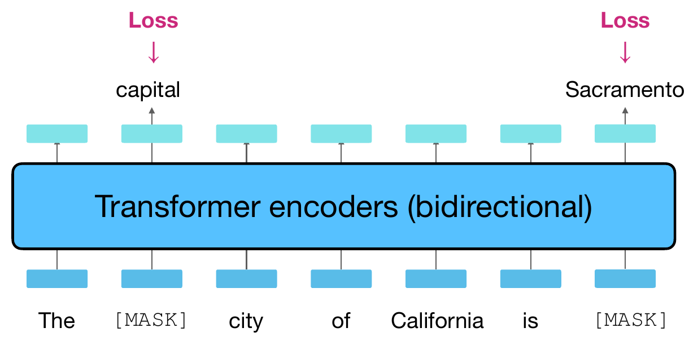

## Our missing-word task becomes masked language modeling {#bert-mlm .bert-slide}

<p class="bert-lead">Our example: <b>the [MASK] sat on the mat</b> → target: <b>cat</b></p>
<p class="bert-caption">Now trace the same mechanism in Berkeley’s two-target example.</p>

{.bert-source-figure fig-alt="Berkeley MLM diagram: The MASK city of California is MASK enters a bidirectional Transformer encoder. Only the selected positions have target labels capital and Sacramento and direct loss terms."}

<p class="bert-takeaway"><strong>Architecture:</strong> read both sides of the supplied input.<br><strong>Objective:</strong> recover original tokens at selected positions.</p>
<p class="s1-source">Diagram cropped from Berkeley CS288, Spring 2026, PDF p. 36; BERT: <a href="https://aclanthology.org/N19-1423/">Devlin et al. (2019), §3.1</a>. Target labels are not measured predictions. Two masks illustrate the mechanism, not a literal 15% rate.</p>

::: {.notes}
TIME: 2 minutes. Continue directly from the approved architecture bridge. We have
already built input–target pairs; BERT gives us a concrete training recipe for an
encoder. Lowercase the running sentence and omit its punctuation throughout this
section to keep token positions stable. This is a teaching convention, not a claim
that all BERT tokenizers lowercase text.

Read Berkeley's diagram bottom to top. The supplied input has two replacements.
The encoder builds a contextual state at every position. A shared vocabulary head
uses selected states to assign probabilities to the original tokens. The labels
capital and Sacramento above the encoder identify the observed targets, not
successful model predictions. The pink Loss labels identify comparison points;
they are not extra input to the encoder. Our cat example uses the same mechanism.

Do not repeat softmax arithmetic. Explain that seeing both sides means seeing
both sides of the CORRUPTED input. It does not grant access to the original hidden
word. This diagram shows only the mask branch; selected positions can also be
randomly replaced or unchanged. We will inspect those cases shortly.
Transition: “What exactly goes into each encoder position?”
:::

## Build the input at each position {#bert-inputs .bert-slide}

<p class="bert-lead">Token identity + position + segment identity → one input vector.</p>

```{=html}
<svg class="bert-input-diagram" viewBox="0 0 1320 455" role="img" aria-label="Eight positions from CLS through SEP. At each position add token, position and segment embeddings; feed the sums to a bidirectional encoder, producing one contextual state per position."><g font-family="sans-serif" text-anchor="middle" fill="#17364a"><text x="220" y="35" font-size="26" font-weight="bold">[CLS]</text><rect x="159" y="65" width="122" height="48" rx="8" fill="#e2eee8"/><text x="220" y="95" font-size="22">E([CLS])</text><rect x="159" y="135" width="122" height="48" rx="8" fill="#f5e4c6"/><text x="220" y="165" font-size="22">P0</text><rect x="159" y="205" width="122" height="48" rx="8" fill="#dce9f0"/><text x="220" y="235" font-size="22">S(A)</text><text x="220" y="132" font-size="22">+</text><text x="220" y="202" font-size="22">+</text><path d="M220 257V285" stroke="#0f7881" stroke-width="3"/><text x="220" y="444" font-size="26">h0</text><path d="M220 378V411" stroke="#0f7881" stroke-width="3"/><text x="357" y="35" font-size="26" font-weight="bold">the</text><rect x="296" y="65" width="122" height="48" rx="8" fill="#e2eee8"/><text x="357" y="95" font-size="22">E(the)</text><rect x="296" y="135" width="122" height="48" rx="8" fill="#f5e4c6"/><text x="357" y="165" font-size="22">P1</text><rect x="296" y="205" width="122" height="48" rx="8" fill="#dce9f0"/><text x="357" y="235" font-size="22">S(A)</text><text x="357" y="132" font-size="22">+</text><text x="357" y="202" font-size="22">+</text><path d="M357 257V285" stroke="#0f7881" stroke-width="3"/><text x="357" y="444" font-size="26">h1</text><path d="M357 378V411" stroke="#0f7881" stroke-width="3"/><text x="494" y="35" font-size="26" font-weight="bold">[MASK]</text><rect x="433" y="65" width="122" height="48" rx="8" fill="#e2eee8"/><text x="494" y="95" font-size="22">E([MASK])</text><rect x="433" y="135" width="122" height="48" rx="8" fill="#f5e4c6"/><text x="494" y="165" font-size="22">P2</text><rect x="433" y="205" width="122" height="48" rx="8" fill="#dce9f0"/><text x="494" y="235" font-size="22">S(A)</text><text x="494" y="132" font-size="22">+</text><text x="494" y="202" font-size="22">+</text><path d="M494 257V285" stroke="#0f7881" stroke-width="3"/><text x="494" y="444" font-size="26">h2</text><path d="M494 378V411" stroke="#0f7881" stroke-width="3"/><text x="631" y="35" font-size="26" font-weight="bold">sat</text><rect x="570" y="65" width="122" height="48" rx="8" fill="#e2eee8"/><text x="631" y="95" font-size="22">E(sat)</text><rect x="570" y="135" width="122" height="48" rx="8" fill="#f5e4c6"/><text x="631" y="165" font-size="22">P3</text><rect x="570" y="205" width="122" height="48" rx="8" fill="#dce9f0"/><text x="631" y="235" font-size="22">S(A)</text><text x="631" y="132" font-size="22">+</text><text x="631" y="202" font-size="22">+</text><path d="M631 257V285" stroke="#0f7881" stroke-width="3"/><text x="631" y="444" font-size="26">h3</text><path d="M631 378V411" stroke="#0f7881" stroke-width="3"/><text x="768" y="35" font-size="26" font-weight="bold">on</text><rect x="707" y="65" width="122" height="48" rx="8" fill="#e2eee8"/><text x="768" y="95" font-size="22">E(on)</text><rect x="707" y="135" width="122" height="48" rx="8" fill="#f5e4c6"/><text x="768" y="165" font-size="22">P4</text><rect x="707" y="205" width="122" height="48" rx="8" fill="#dce9f0"/><text x="768" y="235" font-size="22">S(A)</text><text x="768" y="132" font-size="22">+</text><text x="768" y="202" font-size="22">+</text><path d="M768 257V285" stroke="#0f7881" stroke-width="3"/><text x="768" y="444" font-size="26">h4</text><path d="M768 378V411" stroke="#0f7881" stroke-width="3"/><text x="905" y="35" font-size="26" font-weight="bold">the</text><rect x="844" y="65" width="122" height="48" rx="8" fill="#e2eee8"/><text x="905" y="95" font-size="22">E(the)</text><rect x="844" y="135" width="122" height="48" rx="8" fill="#f5e4c6"/><text x="905" y="165" font-size="22">P5</text><rect x="844" y="205" width="122" height="48" rx="8" fill="#dce9f0"/><text x="905" y="235" font-size="22">S(A)</text><text x="905" y="132" font-size="22">+</text><text x="905" y="202" font-size="22">+</text><path d="M905 257V285" stroke="#0f7881" stroke-width="3"/><text x="905" y="444" font-size="26">h5</text><path d="M905 378V411" stroke="#0f7881" stroke-width="3"/><text x="1042" y="35" font-size="26" font-weight="bold">mat</text><rect x="981" y="65" width="122" height="48" rx="8" fill="#e2eee8"/><text x="1042" y="95" font-size="22">E(mat)</text><rect x="981" y="135" width="122" height="48" rx="8" fill="#f5e4c6"/><text x="1042" y="165" font-size="22">P6</text><rect x="981" y="205" width="122" height="48" rx="8" fill="#dce9f0"/><text x="1042" y="235" font-size="22">S(A)</text><text x="1042" y="132" font-size="22">+</text><text x="1042" y="202" font-size="22">+</text><path d="M1042 257V285" stroke="#0f7881" stroke-width="3"/><text x="1042" y="444" font-size="26">h6</text><path d="M1042 378V411" stroke="#0f7881" stroke-width="3"/><text x="1179" y="35" font-size="26" font-weight="bold">[SEP]</text><rect x="1118" y="65" width="122" height="48" rx="8" fill="#e2eee8"/><text x="1179" y="95" font-size="22">E([SEP])</text><rect x="1118" y="135" width="122" height="48" rx="8" fill="#f5e4c6"/><text x="1179" y="165" font-size="22">P7</text><rect x="1118" y="205" width="122" height="48" rx="8" fill="#dce9f0"/><text x="1179" y="235" font-size="22">S(A)</text><text x="1179" y="132" font-size="22">+</text><text x="1179" y="202" font-size="22">+</text><path d="M1179 257V285" stroke="#0f7881" stroke-width="3"/><text x="1179" y="444" font-size="26">h7</text><path d="M1179 378V411" stroke="#0f7881" stroke-width="3"/><text x="70" y="95" font-size="22">TOKEN</text><text x="70" y="165" font-size="22">POSITION</text><text x="70" y="235" font-size="22">SEGMENT</text><rect x="155" y="286" width="1083" height="92" rx="12" fill="#17364a"/><text x="696" y="325" font-size="30" fill="white">BIDIRECTIONAL TRANSFORMER ENCODER</text><text x="696" y="358" font-size="23" fill="white">each position can use every supplied input position</text></g></svg>
```

<div class="bert-input-key"><p><b>[CLS]</b> supplies a state for sequence-level prediction.</p><p><b>[SEP]</b> marks a boundary. Segment A/B distinguishes two passages.</p></div>
<p class="bert-caption">Shown: one segment, no padding. BERT uses WordPiece tokens and learned position embeddings.</p>
<p class="s1-source">Original example-based drawing following Devlin et al., Fig. 2; Stanford CS224N, PDF pp. 27–28. Each colored box denotes a vector, not a scalar.</p>

::: {.notes}
TIME: 4 minutes. Tokenization was taught earlier; do not reteach its algorithm.
Words can split into WordPieces. Here the short lowercase words are displayed as
individual token positions; punctuation is omitted. Position 0 is CLS, cat was
at position 2, and SEP ends this single segment at position 7. All segment IDs
are A for this example. In a pair, the second passage and its trailing SEP use B.

Trace position 2: E([MASK]) + P2 + S(A) forms the input vector. The three vectors
have the same dimension and are added coordinate by coordinate, not concatenated.
BERT learns the embedding tables, including the position table. The original
cat embedding is not secretly inserted at this masked position. Normalization,
dropout, and the internal Transformer operations are omitted from the drawing.

Every final h is contextual. The MLM head reads h2 to predict cat. CLS is a learned
special token whose final contextual state can feed a sequence-level head; it is
not an arithmetic average of token states. SEP marks a separator/end boundary,
not a target word in our MLM selection. Padding, if used in a batch, is excluded
from selection and hidden with an attention mask. That padding mask is different
from replacing a word by the literal MASK token.

Ask students which vector differs between the two occurrences of the: position
embeddings differ even though the token lookup is shared. No numeric vector
values are claimed. Transition: “Which positions should become prediction targets?”
:::

## First select targets. Then choose their replacement. {#bert-selection .bert-slide}

<p class="bert-lead">Keep two decisions separate: <b>where to predict</b>, then <b>what the input contains</b>.</p>
<div class="bert-selection-layout"><div><span class="lab-label">100 ELIGIBLE POSITIONS · ILLUSTRATIVE SELECTION</span><div class="bert-position-grid" aria-label="100 positions; 15 selected targets and 85 unselected context positions"><span class="context" aria-hidden="true">○</span><span class="context" aria-hidden="true">○</span><span class="chosen" aria-hidden="true">●</span><span class="context" aria-hidden="true">○</span><span class="context" aria-hidden="true">○</span><span class="context" aria-hidden="true">○</span><span class="context" aria-hidden="true">○</span><span class="context" aria-hidden="true">○</span><span class="chosen" aria-hidden="true">●</span><span class="context" aria-hidden="true">○</span><span class="context" aria-hidden="true">○</span><span class="context" aria-hidden="true">○</span><span class="context" aria-hidden="true">○</span><span class="context" aria-hidden="true">○</span><span class="chosen" aria-hidden="true">●</span><span class="context" aria-hidden="true">○</span><span class="context" aria-hidden="true">○</span><span class="context" aria-hidden="true">○</span><span class="context" aria-hidden="true">○</span><span class="context" aria-hidden="true">○</span><span class="context" aria-hidden="true">○</span><span class="chosen" aria-hidden="true">●</span><span class="context" aria-hidden="true">○</span><span class="context" aria-hidden="true">○</span><span class="context" aria-hidden="true">○</span><span class="context" aria-hidden="true">○</span><span class="context" aria-hidden="true">○</span><span class="chosen" aria-hidden="true">●</span><span class="context" aria-hidden="true">○</span><span class="context" aria-hidden="true">○</span><span class="context" aria-hidden="true">○</span><span class="context" aria-hidden="true">○</span><span class="context" aria-hidden="true">○</span><span class="chosen" aria-hidden="true">●</span><span class="context" aria-hidden="true">○</span><span class="context" aria-hidden="true">○</span><span class="context" aria-hidden="true">○</span><span class="context" aria-hidden="true">○</span><span class="context" aria-hidden="true">○</span><span class="context" aria-hidden="true">○</span><span class="chosen" aria-hidden="true">●</span><span class="context" aria-hidden="true">○</span><span class="context" aria-hidden="true">○</span><span class="context" aria-hidden="true">○</span><span class="context" aria-hidden="true">○</span><span class="context" aria-hidden="true">○</span><span class="chosen" aria-hidden="true">●</span><span class="context" aria-hidden="true">○</span><span class="context" aria-hidden="true">○</span><span class="context" aria-hidden="true">○</span><span class="context" aria-hidden="true">○</span><span class="context" aria-hidden="true">○</span><span class="chosen" aria-hidden="true">●</span><span class="context" aria-hidden="true">○</span><span class="context" aria-hidden="true">○</span><span class="context" aria-hidden="true">○</span><span class="context" aria-hidden="true">○</span><span class="context" aria-hidden="true">○</span><span class="context" aria-hidden="true">○</span><span class="chosen" aria-hidden="true">●</span><span class="context" aria-hidden="true">○</span><span class="context" aria-hidden="true">○</span><span class="context" aria-hidden="true">○</span><span class="context" aria-hidden="true">○</span><span class="context" aria-hidden="true">○</span><span class="chosen" aria-hidden="true">●</span><span class="context" aria-hidden="true">○</span><span class="context" aria-hidden="true">○</span><span class="context" aria-hidden="true">○</span><span class="context" aria-hidden="true">○</span><span class="context" aria-hidden="true">○</span><span class="chosen" aria-hidden="true">●</span><span class="context" aria-hidden="true">○</span><span class="context" aria-hidden="true">○</span><span class="context" aria-hidden="true">○</span><span class="context" aria-hidden="true">○</span><span class="context" aria-hidden="true">○</span><span class="context" aria-hidden="true">○</span><span class="chosen" aria-hidden="true">●</span><span class="context" aria-hidden="true">○</span><span class="context" aria-hidden="true">○</span><span class="context" aria-hidden="true">○</span><span class="context" aria-hidden="true">○</span><span class="context" aria-hidden="true">○</span><span class="chosen" aria-hidden="true">●</span><span class="context" aria-hidden="true">○</span><span class="context" aria-hidden="true">○</span><span class="context" aria-hidden="true">○</span><span class="context" aria-hidden="true">○</span><span class="context" aria-hidden="true">○</span><span class="context" aria-hidden="true">○</span><span class="context" aria-hidden="true">○</span><span class="context" aria-hidden="true">○</span><span class="context" aria-hidden="true">○</span><span class="context" aria-hidden="true">○</span><span class="context" aria-hidden="true">○</span><span class="chosen" aria-hidden="true">●</span><span class="context" aria-hidden="true">○</span><span class="context" aria-hidden="true">○</span><span class="context" aria-hidden="true">○</span></div><div class="bert-grid-key"><span>● 15 selected targets</span><span>○ 85 unselected positions</span></div></div><div class="bert-branches"><div><b>80%</b><p>Replace with <strong>[MASK]</strong></p></div><div><b>10%</b><p>Replace with a <strong>random vocabulary token</strong></p></div><div><b>10%</b><p>Keep the <strong>original token</strong></p></div></div></div>
<p class="bert-takeaway">The 80 / 10 / 10 probabilities apply <strong>only within the selected 15%</strong>.</p>
<p class="bert-caption">Keep the original token as the target in every branch. Finite samples need not match the percentages exactly.</p>
<p class="s1-source">Stanford CS224N, PDF p. 27; Berkeley CS288, PDF p. 38; original BERT §3.1. Schematic selection, no sampling or model execution. Exclude [CLS], [SEP], and padding.</p>

::: {.notes}
TIME: 3 minutes. The grid shows 100 eligible positions across a hypothetical batch,
not one fixed-length BERT sentence. Exactly 15 positions are highlighted only to
make the denominator visible. Their spatial pattern is hand chosen, not a sample
from an actual random generator. The diagram does not allocate the 15 highlighted
positions into fractional subgroups. Branch probabilities describe repeated draws.

First decide which WordPiece positions are selected. Then, separately for each
selected position, choose mask/random/unchanged. Selection and corruption are
performed while preparing training examples; they are not model predictions.
The training procedure retains the original token ID before changing the input.

Do not introduce a second arithmetic exercise or ask students to calculate
population percentages here. The next slide inspects one selected position.
Crucial distinction: unselected positions and selected-but-unchanged positions
can look identical to the encoder, yet only the latter get a direct MLM loss.
The selection set is supplied to the loss computation, not as an input flag.
Transition: “What changes when the SAME selected token takes each branch?”
:::

## Select positions first. Then corrupt their inputs. {#bert-corruption .s2-slide .s1-slide .bert-slide}

<div class="s2-policy"><div><b>15%</b><span>of eligible token positions<br>selected as prediction targets</span></div><i>→</i><div><b>80 / 10 / 10</b><span>of those selected: mask / random / unchanged</span></div></div>
<div class="lab-toolbar"><button data-corruption="mask" aria-pressed="true">[MASK] · 80%</button><button data-corruption="random" aria-pressed="false">Random token · 10%</button><button data-corruption="unchanged" aria-pressed="false">Unchanged · 10%</button><span>Inspect one selected position.<br>Same original sentence and target.</span></div>
<div class="s2-corruption-line">the <strong id="corruption-token">[MASK]</strong> sat on the mat</div>
<table class="s2-inspector"><thead><tr><th>Position</th><th>Original</th><th>Model receives</th><th>Loss target</th></tr></thead><tbody><tr><td>3 · not selected</td><td>sat</td><td>sat</td><td>Ignored</td></tr><tr class="selected-row"><td>2 · selected</td><td>cat</td><td id="corruption-cell">[MASK]</td><td>cat · always</td></tr></tbody></table>
<p id="corruption-explanation" class="s2-policy-note" aria-live="polite">The answer disappears from this input position; context must supply evidence.</p>
<p class="s1-source"><a href="https://aclanthology.org/N19-1423/">Devlin et al., 2019</a>, §3.1 · schematic corruption inspector, no model inference. Positions include [CLS] at 0; the random replacement “table” is fixed for inspection.</p>

::: {.notes}
TIME: 5 minutes. Reused from the approved earlier corruption inspector, with our running sentence.
The first probability is about selection, the other three are conditional on having been selected. A short classroom sentence with one selected position is not a literal 15% sample. Real training selects WordPiece positions, excluding CLS/SEP here. The unselected row has no direct MLM loss term, but contextual tokens can still receive gradients through their influence on a selected output. Click each branch. Random replacement is a vocabulary token, not an intentional misspelling. Unchanged selected positions still have cat as their loss target, whereas unselected sat has no target in this objective. These occasional unchanged targets are easier; their purpose is to reduce dependence on the artificial MASK input, not to eliminate all copying on every training example. The model is not given a separate selected-position flag. The loss computation knows which positions were selected. Explain the motivation: downstream inputs usually contain no MASK token. Mixing corruption branches reduces reliance on that artificial marker, without removing the mismatch completely. Keep the target fixed while clicking all three buttons, then ask why selected-but-unchanged and unselected positions have different loss treatment. Transition: “How do we turn selected predictions into one loss?”
:::

## Which probabilities should training reward? {#bert-loss-pause .s2-slide .bert-slide}

<div class="s2-source-sentence"><span>ORIGINAL</span>the <b>cat</b> sat on the <b>mat</b></div>
<div class="s2-cloze s2-double-mask"><span>the</span><strong>[MASK]</strong><span>sat on the</span><strong>[MASK]</strong></div>
<table class="s2-loss-table"><thead><tr><th>Selected target</th><th>p(original token | corrupted input)</th></tr></thead><tbody><tr><td>cat</td><td>0.25</td></tr><tr><td>mat</td><td>0.50</td></tr></tbody></table>
<div class="s1-pause"><strong>PAUSE</strong><span>60 seconds</span><p>Compute the mean loss over the two selected positions.<br>Use −ln(p) per target. Which prediction contributes more?</p></div>
<p class="s2-math-hint">Given: ln(2) ≈ 0.693 and ln(4) ≈ 1.386.<br>Ignore all unselected positions. Use natural logarithms.</p>
<p class="s1-source">Illustrative probabilities, not measured BERT outputs. Both blanks are present in the same model input.</p>

::: {.notes}
TIME: 2 minutes, including a 60-second PAUSE.
Leave the exact task and givens visible without revealing an answer. Ask students to compute each term and average across the two selected positions, not all six words. The probabilities are intentionally simple, normalized vocabulary probabilities supplied as givens. They are not the top-five scores from the previous experiment. Selecting two out of six positions here is a loss example, not the original masking rate. No assumption of statistically independent words is required to define this summed training objective.
:::

## From two errors to the masked-language-model loss {#bert-loss-solution .s2-slide .bert-slide}

<div class="s2-worked"><div><span>cat · p = 0.25</span><strong>−ln(0.25) = 1.386</strong></div><div><span>mat · p = 0.50</span><strong>−ln(0.50) = 0.693</strong></div></div>
<div class="s2-loss-answer">Mean = (1.386 + 0.693) / 2 ≈ <b>1.040 nats</b></div>
<div class="s2-formula">

$$\mathcal{L}_{\mathrm{MLM}}(\theta) = -\frac{1}{|M|}\sum_{i\in M}\log p_\theta(x_i\mid\widetilde{x})$$

</div>
<div class="s2-notation"><p><b>x</b><br>original tokens<br>the cat sat on the mat</p><p><b>x̃</b><br>corrupted input<br>the [MASK] sat on the [MASK]</p><p><b>M</b><br>selected positions<br>{cat position, mat position}</p></div>
<p class="s2-conclusion">A smaller probability for the observed token means a larger penalty.</p>
<p class="s1-source">Mean cross-entropy over selected positions · one training example shown; training averages over examples and corruption draws. Gradients update the prediction head and contextual reader.</p>

::: {.notes}
TIME: 3 minutes.
The cat term is twice the mat term here. Keep the example visible while mapping to x, corrupted x, and M. M includes every selected position, even when its input is a random token or unchanged. The normalization shown is our per-example mean convention; batching can average over all selected tokens. The MLM head produces vocabulary logits from contextual states, and softmax converts them into the probabilities used here. Backpropagation connects these errors to the head, Transformer layers, and embeddings. This is a sum of token prediction losses conditioned on the same corrupted sequence, not a left-to-right factorization of the probability of the complete sentence. No additional hand labels were supplied. An unselected position has no direct MLM term, but its embedding and internal states can receive gradients through selected predictions that attend to it. All encoder layers and the vocabulary head are trained. Transition: “Original BERT also learns from how passages are paired.”
:::

## Original BERT also asked: do these passages follow? {#bert-nsp .s2-slide .bert-slide}

<div class="s2-document"><span class="lab-label">A SHORT DOCUMENT · AUTHORED EXAMPLE</span><p><b>A</b> Sara opened her book.</p><p><b>B</b> She began to read.</p></div>
<div class="s2-nsp-pairs"><div><span>50% · actual continuation</span><p>A + “She began to read.”</p><strong>IsNext</strong></div><div><span>50% · random corpus passage</span><p>A + “The train arrived late.”</p><strong>NotNext</strong></div></div>
<div class="s2-nsp-sequence"><b>[CLS]</b><span>passage A</span><b>[SEP]</b><span>passage B</span><b>[SEP]</b></div>
<p class="s2-nsp-equation">[CLS] representation → binary classifier</p>
<p class="s2-conclusion">Original training objective: <b>MLM loss + NSP loss.</b></p>
<p class="s1-source"><a href="https://aclanthology.org/N19-1423/">Devlin et al., 2019</a>, §3.1 · NSP = next sentence prediction. The labels come from document order and sampling; no human annotation.</p>

::: {.notes}
TIME: 3 minutes. Brief historical context; no ablation table in this increment. Original BERT forms two text segments, which may contain more than a grammatical sentence. The classifier uses the final CLS representation; token-level MLM predictions use the selected token representations. Segment embeddings distinguish A and B in addition to SEP delimiters. MLM corruption is omitted from this schematic to make the pair construction legible; both objectives operate during original pretraining. NSP classifies actual adjacency versus a sampled alternative; it is not a test of truth, and a random continuation can sound plausible. The 50/50 proportions refer to training pair construction. Do not claim NSP is essential to all later encoder recipes. Keep model architecture separate from this historical recipe. Ask where the binary labels came from: document order and sampling. Transition: “Once trained, which states can a new task use?”
:::

## Reuse the encoder. Change the prediction head. {#bert-reuse-preview .bert-slide}

<p class="bert-lead">One learned backbone → different output interfaces.</p>

```{=html}
<svg class="bert-reuse-diagram" viewBox="0 0 1320 470" role="img" aria-label="Two separate copies of pretrained BERT. For sentiment, the CLS state feeds a sentence classifier. For entity labeling, each word state feeds a shared token classifier. Example labels are training targets, not measured outputs.">
<defs><marker id="br-arrow" viewBox="0 0 10 10" refX="9" refY="5" markerWidth="7" markerHeight="7" orient="auto"><path d="M0 0L10 5L0 10Z" fill="#0f7881"/></marker></defs>
<g font-family="sans-serif" fill="#17364a" text-anchor="middle">
<text x="310" y="35" font-size="30" font-weight="bold">ONE LABEL PER SEQUENCE</text><text x="1010" y="35" font-size="30" font-weight="bold">ONE LABEL PER TOKEN</text>
<text x="310" y="105" font-size="36" fill="#a34832">positive</text><text x="850" y="105" font-size="30" fill="#a34832">PERSON</text><text x="1030" y="105" font-size="30">O</text><text x="1210" y="105" font-size="30" fill="#a34832">LOCATION</text>
<rect x="160" y="140" width="300" height="65" rx="10" fill="#f5e4c6"/><text x="310" y="181" font-size="27">sequence classifier</text>
<rect x="755" y="140" width="540" height="65" rx="10" fill="#f5e4c6"/><text x="1025" y="181" font-size="27">shared token classifier</text>
<path d="M310 135V115M310 280V215M850 280V215M1030 280V215M1210 280V215M850 135V115M1030 135V115M1210 135V115" stroke="#0f7881" stroke-width="3" marker-end="url(#br-arrow)"/>
<text x="370" y="250" font-size="25">h[CLS]</text><text x="850" y="253" font-size="25">h₁</text><text x="1030" y="253" font-size="25">h₂</text><text x="1210" y="253" font-size="25">h₃</text>
<rect x="45" y="285" width="550" height="90" rx="10" fill="#17364a"/><rect x="725" y="285" width="580" height="90" rx="10" fill="#17364a"/><text x="320" y="340" font-size="32" fill="white">pretrained BERT</text><text x="1015" y="340" font-size="32" fill="white">pretrained BERT</text>
<text x="320" y="435" font-size="29">[CLS] I loved this film [SEP]</text><text x="1015" y="435" font-size="29">[CLS] Sara visited Paris [SEP]</text>
</g></svg>
```

<p class="bert-takeaway">New task labels train the new head. In full fine-tuning, <strong>the encoder also changes</strong>.</p>
<p class="bert-caption">Session 2 will unpack these updates. Here, identify which contextual state each head reads.</p>
<p class="s1-source">Original diagrams adapted from Berkeley CS288, PDF pp. 43–46, and BERT Fig. 1. Illustrative target labels; O = outside a named entity. Word-level alignment shown; subword alignment deferred.</p>

::: {.notes}
TIME: 3 minutes. This is a preview of usefulness, not the detailed adaptation
section reserved for Session 2. Read both diagrams bottom to top. On the left,
the final CLS state feeds a classifier with task labels such as positive/negative.
On the right, a shared classifier reads each token state and predicts its entity
label. The shown words stand in for aligned token states; actual subword handling
requires an explicit labeling convention. O means outside an entity. Special
tokens receive no entity labels in this illustration.

The outputs are authored target labels, not measured model predictions. Neither
head arrives trained for these tasks merely because MLM pretraining finished.
Each task uses its own model copy initialized from the same pretrained backbone.
Task training normally uses complete text rather than artificial MLM masks.
Full fine-tuning updates the backbone and the newly attached head together;
using frozen features is another possibility we will compare in Session 2.

Keep this focused on the interface: a sequence state versus per-token states.
The expensive reusable object is the learned parameter set, not a cache of the
specific cat sentence's vectors. Ask which head the personal-data masking student
project resembles. Transition: “This gives us a reader. What if we need to continue
text when the words on the right do not exist yet?”
:::

## A reader can use the right context. A writer must create it. {#bert-to-gpt .bert-slide}

<div class="bert-recap"><span><b>SEES</b>Both sides of corrupted input</span><span><b>LEARNS</b>Original tokens at selected positions</span><span><b>REUSES</b>Trained encoder parameters</span></div>

```{=html}
<svg class="bert-generation-bridge" viewBox="0 0 1320 420" role="img" aria-label="Top: the missing cat has existing context on both sides. Bottom: the prefix the cat sat on reaches an unknown continuation. Animated paths show available context flowing to the prediction position.">
<defs><marker id="bg-arrow" viewBox="0 0 10 10" refX="9" refY="5" markerWidth="7" markerHeight="7" orient="auto"><path d="M0 0L10 5L0 10Z" fill="#0f7881"/></marker></defs>
<g font-family="sans-serif" fill="#17364a" text-anchor="middle">
<text x="160" y="60" font-size="24">RECOVER A GAP</text><text x="160" y="143" font-size="39">the</text><rect x="350" y="90" width="240" height="80" rx="10" fill="#f5e4c6"/><text x="470" y="143" font-size="39">[MASK]</text><text x="940" y="143" font-size="39">sat on the mat</text>
<path class="bert-flow" d="M160 165V215H460V180M940 165V215H480V180"/>
<text x="230" y="285" font-size="24">CONTINUE A PREFIX</text><text x="350" y="360" font-size="39">the cat sat on</text><rect x="760" y="302" width="170" height="80" rx="10" fill="#f5e4c6"/><text x="845" y="357" font-size="46">?</text><text x="1110" y="335" font-size="26">right context</text><text x="1110" y="372" font-size="26">does not exist yet</text><path class="bert-flow" d="M555 342H745"/>
</g></svg>
```

<p class="bert-question">How should the training task change when only the prefix is available?</p>
<p class="s1-source">Conceptual information flow, not measured attention. Next: GPT and causal prediction. BERT-style encoders can support other generation procedures; the original MLM recipe is not a left-to-right generation recipe.</p>

::: {.notes}
TIME: 2 minutes. Synthesize BERT before raising the next question. It reads the
supplied corrupted sequence, learns original selected tokens, and yields weights
we can reuse. Recall that random and unchanged selected positions also belong to
its loss set. The NSP objective was an additional part of the original recipe.

Trace the moving dashed paths: they show allowed information flowing into a
prediction, not learned attention magnitudes or a running model. The upper gap
has words on both sides already available. The lower prefix has no existing right
context. We cannot reveal future words during a task meant to predict them from
the past. Do not introduce GPT's shifted target equation or causal factorization
here; leave that mechanism for the next reviewed section.

Avoid the absolute claim that BERT cannot generate text. The limitation motivating
our next recipe is that masked reconstruction does not directly train the ordinary
left-to-right continuation procedure. End with the displayed question and stop.
:::
