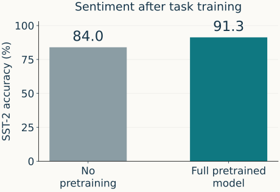
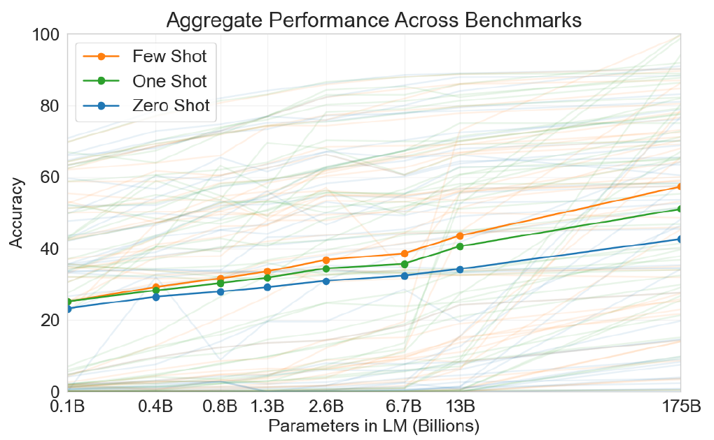

## GPT: the task interface changes {#gt-trajectory .gt-slide}

Same family of pretraining objective. A changing answer to: <strong>how do we specify the task?</strong>

2018 · GPT<strong>Adapt the weights</strong>
Pretrain on text, then fine-tune for a labeled task.
<b>≈117M parameters</b>

2019 · GPT-2<strong>Condition on text</strong>
Investigate task behavior without task-specific gradient updates.
<b>Up to ≈1.5B</b>

2020 · GPT-3<strong>Demonstrate in context</strong>
Compare zero-, one-, and few-shot evaluation across sizes.
<b>Up to 175B</b>

<strong>Our running task stays sentiment.</strong>
Where does the information connecting a review to its label enter the system?

Sources: <a href="https://cdn.openai.com/research-covers/language-unsupervised/language_understanding_paper.pdf">Radford et al., 2018</a>; <a href="https://cdn.openai.com/better-language-models/language_models_are_unsupervised_multitask_learners.pdf">Radford et al., 2019</a>; <a href="https://arxiv.org/abs/2005.14165">Brown et al., 2020</a>. Representative sizes; GPT-2 and GPT-3 each study multiple sizes.

::: {.notes}
TIME: 2 minutes. Locate this section after sentiment fine-tuning. The timeline is
an orientation, not three new architectures to derive. Ask where task information
enters before following the arrows on the next slide. These are research milestones,
not a claim that prompting replaced fine-tuning or that later models cannot be fine-tuned.
Parameter counts describe model capacity, not the number of examples in a prompt.
The original GPT is commonly described as 117M; GPT-2 paper counts are used here.
:::

## GPT: transfer still uses task labels {#gt-transfer .gt-slide}

Recall the sentiment result. Now identify what produced it.

PRETRAINING<strong>BooksCorpus → saved decoder weights</strong>

SUPERVISED ADAPTATION<strong>Annotated reviews → decoder + classification head updates</strong>

Read the final token’s state to classify the review; do not transplant BERT’s bidirectional [CLS] diagram.

What if we supplied the task as text instead of training a new classifier?

<a href="https://cdn.openai.com/research-covers/language-unsupervised/language_understanding_paper.pdf#page=8">Radford et al. (2018), §3.2 and Table 5</a>. Reused chart; both conditions use task labels. Full model includes auxiliary LM loss during fine-tuning. Not an equal-total-compute comparison.

::: {.notes}
TIME: 2 minutes. Reuse the already-discussed evidence rather than presenting a new
benchmark catalogue. The chart establishes the value of initialization in this
setting; it does not show zero-shot sentiment. A review and its annotation enter
task training. At test time, a new review uses the adapted parameters.
Trace the distinction from the preceding encoder section: the causal decoder reads
the final position for the classification interface. No attention derivation here.
The paper table does not explicitly identify its split or report uncertainty;
do not add either claim. Transition from learned task parameters to textual context.
:::

## GPT-2: put the task into the text {#gt-text-interface .gt-slide}

A language model can receive a task-shaped prefix and score its continuation.

ILLUSTRATIVE SENTIMENT PREFIX · NOT A MEASURED GPT-2 OUTPUT
Review: Uneven, yet moving. Sentiment: <b class="gt-slot">?</b>

INPUT<strong>Review + label cue</strong>
<b>→</b>
FIXED CHECKPOINT<strong>Pretrained decoder</strong>
<b>→</b>
OUTPUT INTERFACE<strong>Score label text</strong>

“positive” and “negative” are now candidate text continuations, rather than rows of a newly trained classifier.

A plausible continuation is not automatically a reliable task answer.

Task-as-conditioning idea: <a href="https://cdn.openai.com/better-language-models/language_models_are_unsupervised_multitask_learners.pdf#page=2">Radford et al. (2019), §2</a>. Authored sentiment schematic, not a reported sentiment experiment. Candidate scoring and prompt sensitivity are developed in the next section.

::: {.notes}
TIME: 2 minutes. Keep the same review visible, and leave the output unresolved.
The cue changes the input, not the checkpoint. We are proposing a sentiment
interface to make that difference inspectable; do not claim that GPT-2 reliably
answers this exact prompt. Multi-token labels need sequence scoring and a stated
comparison rule; defer implementation to the in-context-learning section.
This is not a chat assistant trained to obey arbitrary instructions. A task-shaped
prefix is a hypothesis about how to elicit useful behavior from a text predictor.
:::

## GPT-2: transfer improves, but unevenly {#gt-gpt2-evidence .gt-slide}

Language modeling on held-out benchmark text · no task-specific fine-tuning

<table class="gt-table"><thead><tr><th>GPT-2 size <small>paper counts</small></th><th>Penn Treebank <small>Perplexity ↓</small></th><th>One Billion Word <small>Perplexity ↓</small></th></tr></thead><tbody>
<tr><th>117M</th><td>65.85</td><td>75.20</td></tr>
<tr><th>345M</th><td>47.33</td><td>55.72</td></tr>
<tr><th>762M</th><td>40.31</td><td>44.575</td></tr>
<tr class="gt-highlight"><th>1,542M</th><td>35.76</td><td>42.16</td></tr>
<tr><th>Prior best reported</th><td>46.54</td><td>21.8</td></tr>
</tbody></table>

<strong>Read down each column:</strong> larger GPT-2 models improve. The largest beats the listed PTB baseline but remains worse on 1BW.

Exact selected values: <a href="https://cdn.openai.com/better-language-models/language_models_are_unsupervised_multitask_learners.pdf#page=5">Radford et al. (2019), Table 3 / §3.1</a>. Baselines differ by dataset and training setup. Perplexities are not comparable across columns; preprocessing and tokenization matter.

::: {.notes}
TIME: 3 minutes. Establish the metric before comparing rows: lower perplexity means
higher probability assigned to the observed benchmark text under the evaluation
protocol. This is language-model evidence, not a second worked application.
Read within each column. The prior-best row is context from the paper, not a
matched model trained on the same data or compute. The paper discusses invertible
detokenization and the sentence-shuffled structure of 1BW as evaluation issues.
Do not infer that model size alone caused every cross-system difference. Ask which
claim the table supports: useful transfer, not universal task mastery.
:::

## GPT-3: examples enter the context, not the optimizer {#gt-context .gt-slide}

Hold the query fixed. Change the demonstrations that precede it.

ZERO-SHOT · NO DEMONSTRATIONS
Label the sentiment. Use positive or negative.

Review: Uneven, yet moving. Sentiment: <b>?</b>

ONE-SHOT · ONE DEMONSTRATION
Review: Beautiful images cannot rescue its empty characters. Sentiment: negative

Review: Uneven, yet moving. Sentiment: <b>?</b>

<strong>Few-shot:</strong> several demonstrations before the same query. <strong>In all three:</strong> the checkpoint stays fixed during evaluation.

Definitions: <a href="https://arxiv.org/abs/2005.14165">Brown et al. (2020), §2</a>. Authored sentiment examples, not measured predictions. Same instruction applies in both panels; the right panel abbreviates it for space.

::: {.notes}
TIME: 3 minutes. Point to the sole change: a labeled example enters the context.
Do not reveal a fabricated output. Ask students whether a label in this prompt
necessarily implies supervised gradient training; it does not. There is still
supervision in the supplied demonstration, but it is used as conditioning text.
Keep the distinction between pretrained parameters and input-dependent hidden
states from the reuse section. Fixed weights do not mean fixed activations.
The next section will examine prompt construction, example selection and failure
modes; this slide only establishes the historical evaluation protocol.
:::

## GPT-3: scale changes the value of demonstrations {#gt-gpt3-evidence .gt-slide}

Original Figure 1.3 · 42 accuracy-based evaluations · no task-specific gradient updates

READ THE FIGURE
<b>Horizontal:</b> parameter count, logarithmic scale.

<b>Vertical:</b> accuracy; faint lines show individual evaluations.

<b>Compare:</b> zero-, one-, and few-shot at a fixed size.

<strong>Evidence of a trend, not a universal score:</strong> the authors caution that this aggregate is not a rigorous benchmark. Tasks behave differently.

<a href="https://arxiv.org/pdf/2005.14165#page=5">Brown et al. (2020), Figure 1.3, p. 5; Table 2.1</a>. Original figure cropped, curves unchanged. Models trained for 300B tokens each; larger models therefore did not use equal training compute. Few-shot example counts vary by task.

::: {.notes}
TIME: 4 minutes. Let students inspect the axes and legend before giving the reading.
Ask for a comparison at one model size, then across sizes. Faint trajectories warn
against treating the aggregate as a guarantee for sentiment or any particular task.
No points have been digitized or invented. This is the published plot at readable
size. The different prompting conditions share a checkpoint at each size; model
sizes do not share a compute budget. Do not call the graph a controlled proof that
parameter count is the best investment. Save the allocation analysis for scaling.
Transition: consolidate the task interface, then investigate how context is used.
:::

## The interface changed; the learning question remains {#gt-bridge .gt-slide}

<table class="gt-table gt-comparison"><thead><tr><th>Milestone</th><th>Pretraining data</th><th>Task information enters through…</th></tr></thead><tbody>
<tr><th>GPT · ≈117M</th><td>BooksCorpus</td><td>Supervised parameter updates</td></tr>
<tr><th>GPT-2 · up to ≈1.5B</th><td>WebText</td><td>Text conditioning in zero-shot transfer experiments</td></tr>
<tr><th>GPT-3 · up to 175B</th><td>Filtered web, books, Wikipedia <small>300B training tokens</small></td><td>Instructions / demonstrations in the evaluation context</td></tr>
</tbody></table>

FINE-TUNING<strong>Labeled examples → optimizer → changed weights</strong>

IN-CONTEXT USE<strong>Labeled examples → input context → changed states</strong>

Are examples in a prompt doing the same job as supervised fine-tuning?

Synthesis of <a href="https://cdn.openai.com/research-covers/language-unsupervised/language_understanding_paper.pdf">GPT (2018)</a>, <a href="https://cdn.openai.com/better-language-models/language_models_are_unsupervised_multitask_learners.pdf">GPT-2 (2019)</a>, and <a href="https://arxiv.org/abs/2005.14165">GPT-3 (2020)</a>. Historical study settings, not architectural restrictions. Corpus size and training-token count are different quantities.

::: {.notes}
TIME: 4 minutes. Synthesize through the table rather than reciting architecture.
Ask students to trace one annotated review along each bottom path: where does it
enter, and what persists when the context is removed? Do not claim that the two
routes have equivalent behavior. Retain the final question as the opening of the
next section. This completes the authorized 20-minute GPT trajectory only.
In-context-learning details, scaling laws and Chinchilla are not developed here.
:::
