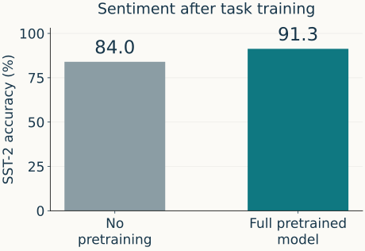

## A new review enters the saved model {#reuse-checkpoint .reuse-slide}

<p class="reuse-lead">Start where Session 1 ended: <strong>“I loved this film.”</strong></p>

```{=html}
<svg class="syn-weights-diagram" viewBox="0 0 1320 370" role="img" aria-label="A saved checkpoint contains learned weights. Supplying a new sentence to those weights computes new contextual states. Those states are outputs for that input, while the saved parameters can be reused again.">
<defs><marker id="reuse-arrow" viewBox="0 0 10 10" refX="9" refY="5" markerWidth="7" markerHeight="7" orient="auto"><path d="M0 0L10 5L0 10Z" fill="#0f7881"/></marker></defs>
<g font-family="sans-serif" fill="#17364a" text-anchor="middle"><rect x="35" y="140" width="365" height="145" rx="12" fill="#17364a"/><text x="217" y="192" font-size="28" fill="white" font-weight="bold">SAVED CHECKPOINT θ*</text><text x="217" y="243" font-size="27" fill="white">learned parameter arrays</text>
<rect x="485" y="20" width="515" height="75" rx="12" fill="#f0e6d4"/><text x="742" y="68" font-size="32">“I loved this film.”</text><path d="M742 105V158" stroke="#0f7881" stroke-width="3" marker-end="url(#reuse-arrow)"/>
<path d="M410 210H555" stroke="#0f7881" stroke-width="3" marker-end="url(#reuse-arrow)"/><rect x="570" y="170" width="340" height="115" rx="12" fill="#dfece6"/><text x="740" y="218" font-size="29">Forward computation</text><text x="740" y="257" font-size="25">uses the saved weights</text>
<path d="M920 225H1025" stroke="#0f7881" stroke-width="3" marker-end="url(#reuse-arrow)"/><rect x="1040" y="170" width="250" height="115" rx="12" fill="#dde8f0"/><text x="1165" y="217" font-size="32">h₁, h₂, …</text><text x="1165" y="259" font-size="24">contextual states</text>
<text x="217" y="345" font-size="26">Reusable across inputs</text><text x="1040" y="345" font-size="26">Computed for this input</text></g></svg>
```

<div class="reuse-pair"><div><span class="reuse-label">CHANGE THE INPUT</span><p>“I disliked this film.”</p><strong>New contextual states</strong><p>The saved weights can stay fixed.</p></div><div><span class="reuse-label">DEFINE THE TASK</span><p>Review → <strong>positive / negative</strong></p><strong>A sentiment decision</strong><p>This output rule still needs to be established.</p></div></div>
<p class="reuse-summary">A checkpoint is reusable knowledge in parameters; a representation is a computation for one input.</p>
<p class="s1-source">Reuses Session 1’s weights-to-states diagram. Sentences and labels are authored examples, not measured predictions. Keep the tokenizer and configuration with the weights.</p>

::: {.notes}
TIME: 2 minutes. Point at the same saved weights and change only loved to disliked.
Ask which objects are recomputed: token IDs can change, and contextual states are
recomputed. A forward pass alone does not update the checkpoint. Do not claim that
these particular states already separate positive and negative reviews perfectly.
The target label is supplied by the task annotation, not by the pretraining recipe.
For this diagram, think of BERT encoder states; for a decoder family the usable
states and input interface differ. No numerical vectors or model outputs are fabricated.
Transition: which learned components do our three recipes make available?
:::

## Three routes to a reusable backbone {#reuse-recipes .reuse-slide}

<p class="reuse-lead">Recall the training signal once; now follow the learned parameters.</p>
<table class="reuse-table"><thead><tr><th>Recipe</th><th>Signal from text</th><th>Learned components available for reuse</th></tr></thead><tbody><tr><th>BERT</th><td>Recover selected tokens</td><td>Token embeddings + bidirectional encoder</td></tr><tr><th>GPT</th><td>Predict the next token</td><td>Token embeddings + causal decoder</td></tr><tr><th>T5</th><td>Reconstruct missing spans</td><td>Embeddings + encoder + decoder</td></tr></tbody></table>
<div class="reuse-question"><span>COMMON PRODUCT</span><strong>A pretrained parameter state θ*</strong><p>Vocabulary heads may be retained or replaced according to the downstream interface. The recipe does not restrict the model to one application.</p></div>
<p class="s1-source">Representative recipes: <a href="https://aclanthology.org/N19-1423/">Devlin et al. (2019)</a>; <a href="https://cdn.openai.com/research-covers/language-unsupervised/language_understanding_paper.pdf">Radford et al. (2018)</a>; <a href="https://jmlr.org/papers/v21/20-074.html">Raffel et al. (2020)</a>. Original BERT also trained NSP; tied parameters remain shared.</p>

::: {.notes}
TIME: 2 minutes. Retrieve the three signals without repeating masks, loss arithmetic,
attention, or autoregressive decoding. The last column lists the backbone, not every
array in the checkpoint: pretraining heads were learned too. A GPT model can support
classification; T5 can represent a class as output text. Explain neither task head
nor prompting yet. Ask: is a saved checkpoint useful because it has this architecture,
or because of the parameter values it learned? The ablation on the next slide helps
separate these explanations within the paper's setting.
:::

## Did pretraining help beyond the architecture? {#reuse-evidence .reuse-slide}

<p class="reuse-lead">Original GPT · supervised downstream evaluation · Table 5 ablation</p>
<div class="reuse-evidence-grid"><div><table class="reuse-results"><thead><tr><th>Task<br><small>Accuracy (%) ↑</small></th><th>No pretraining</th><th>Full pretrained model</th></tr></thead><tbody><tr><th>SST-2<br><small>Sentiment</small></th><td>84.0</td><td>91.3</td></tr><tr><th>MNLI<br><small>Inference</small></th><td>75.7</td><td>81.8</td></tr><tr><th>QNLI<br><small>Question–sentence inference</small></th><td>71.2</td><td>88.1</td></tr></tbody></table></div><div></div></div>
<p class="reuse-summary"><strong>Evidence:</strong> pretraining improved downstream accuracy in this study.</p>
<p class="reuse-limit">Both conditions use task labels. Extra pretraining data and compute are part of this comparison.</p>
<p class="s1-source">Selected columns, exact reported values: <a href="https://cdn.openai.com/research-covers/language-unsupervised/language_understanding_paper.pdf#page=8">Radford et al. (2018), Table 5 and §5, PDF p. 8</a>. Chart redrawn from SST-2 values. “Full” includes an auxiliary LM objective during fine-tuning. No uncertainty estimates are reported in this table.</p>

::: {.notes}
TIME: 3 minutes. Read the task and metric first. SST-2 is binary sentiment; MNLI is
natural-language inference; QNLI is a question–sentence inference task, not extractive
span scoring. All three displayed columns report accuracy. Other columns in the paper
use different metrics; do not average the displayed numbers into a new general score.
The full paper rows are “Transformer w/ aux LM (full)” and “Transformer w/o pre-training”.
These are the authors' reported ablations, not a new replication or equal-compute trial.
The table does not explicitly name its evaluation split; do not invent a dev/test claim.
The full model first learns on BooksCorpus and is then adapted with task labels. The
comparison model is directly trained on supervised tasks. The full pipeline includes
an auxiliary LM objective during fine-tuning; its separate ablation is not shown here.
Explain the axes: SST-2 accuracy from zero to 100, two reported values, not a learning
curve. There are no uncertainty intervals in Table 5; do not infer statistical significance.
Ask students what they can conclude: transferable pretraining is useful in this setting.
What they cannot conclude: unlabeled data eliminates task labels, or GPT beats every
encoder. Historical importance: a general LM backbone can be reused across tasks.
Transition: what must connect the reused representation to the sentiment label?
:::

## Reusable weights are the starting point {#reuse-bridge .reuse-slide}

<p class="reuse-lead">Carry the same example into the next section.</p>
<div class="reuse-bridge-flow"><div><span>INPUT</span><strong>“I loved this film.”</strong><p>Observed review</p></div><b aria-hidden="true">→</b><div><span>PRETRAINED BACKBONE</span><strong>Contextual representation</strong><p>Computed with learned weights</p></div><b aria-hidden="true">→</b><div class="reuse-unknown"><span>NEW TASK INTERFACE</span><strong>?</strong><p>positive / negative</p></div></div>
<div class="reuse-synthesis"><p><strong>Keep:</strong> learned parameters and their matching input conventions.</p><p><strong>Recompute:</strong> representations for each new example.</p><p><strong>Evaluate:</strong> performance on the downstream task, against a stated baseline.</p></div>
<p class="reuse-next">How do we turn the review’s representation into a sentiment decision—and which weights should learn?</p>
<p class="s1-source">Conceptual bridge, not a measured prediction. The next section introduces the classification head and compares frozen features with full fine-tuning.</p>

::: {.notes}
TIME: 2 minutes. Compact synthesis, then collect initial answers to the final question.
The question-mark box deliberately leaves the classifier mechanism unresolved. Do not
show the head equation, classification loss, or full/frozen update controls yet: those
belong to the next approved 25-minute section. The research result motivates adapting
a pretrained model but does not determine the best adaptation strategy for every task.
This is the end of the first Session 2 increment. Stop for instructor review.
:::
