## GPT: model and pretraining data {#gt-trajectory .stanford-source-slide}

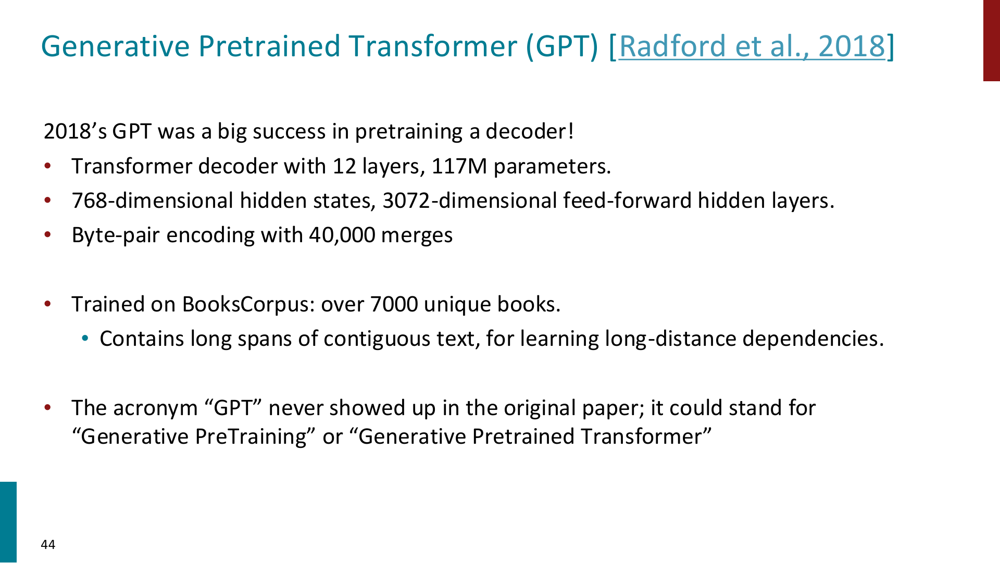

Stanford CS224N · supplied pretraining lecture · slide 44 (PDF p. 42) · <a href="https://cdn.openai.com/research-covers/language-unsupervised/language_understanding_paper.pdf">GPT paper</a>

::: {.notes}
Original reference slide, reproduced directly from the instructor-supplied PDF.
Present the original slide in its original sequence; retain its examples and research evidence.

Accessible text from source:

Generative Pretrained Transformer (GPT) [Radford et al., 2018]

2018’s GPT was a big success in pretraining a decoder!
• Transformer decoder with 12 layers, 117M parameters.
• 768-dimensional hidden states, 3072-dimensional feed-forward hidden layers.
• Byte-pair encoding with 40,000 merges

• Trained on BooksCorpus: over 7000 unique books.
   • Contains long spans of contiguous text, for learning long-distance dependencies.

• The acronym “GPT” never showed up in the original paper; it could stand for
  “Generative PreTraining” or “Generative Pretrained Transformer”

44
:::

## GPT: formatting inputs for fine-tuning {#stanford-gpt-input .stanford-source-slide}

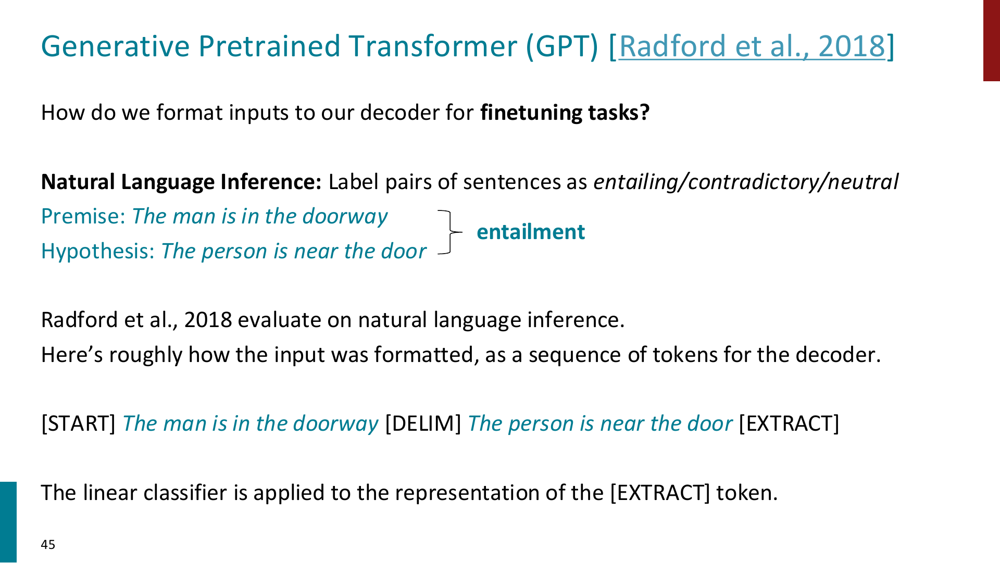

Stanford CS224N · supplied pretraining lecture · slide 45 (PDF p. 43) · <a href="https://cdn.openai.com/research-covers/language-unsupervised/language_understanding_paper.pdf">GPT paper</a>

::: {.notes}
Original reference slide, reproduced directly from the instructor-supplied PDF.
This is the reference slide’s original NLI example, retained to explain GPT input formatting, not an additional application section. The classifier reads EXTRACT after both sentences.

Accessible text from source:

Generative Pretrained Transformer (GPT) [Radford et al., 2018]
How do we format inputs to our decoder for finetuning tasks?

Natural Language Inference: Label pairs of sentences as entailing/contradictory/neutral
Premise: The man is in the doorway
                                            entailment
Hypothesis: The person is near the door

Radford et al., 2018 evaluate on natural language inference.
Here’s roughly how the input was formatted, as a sequence of tokens for the decoder.

[START] The man is in the doorway [DELIM] The person is near the door [EXTRACT]

The linear classifier is applied to the representation of the [EXTRACT] token.

45
:::

## GPT: published inference results {#stanford-gpt-results .stanford-source-slide}

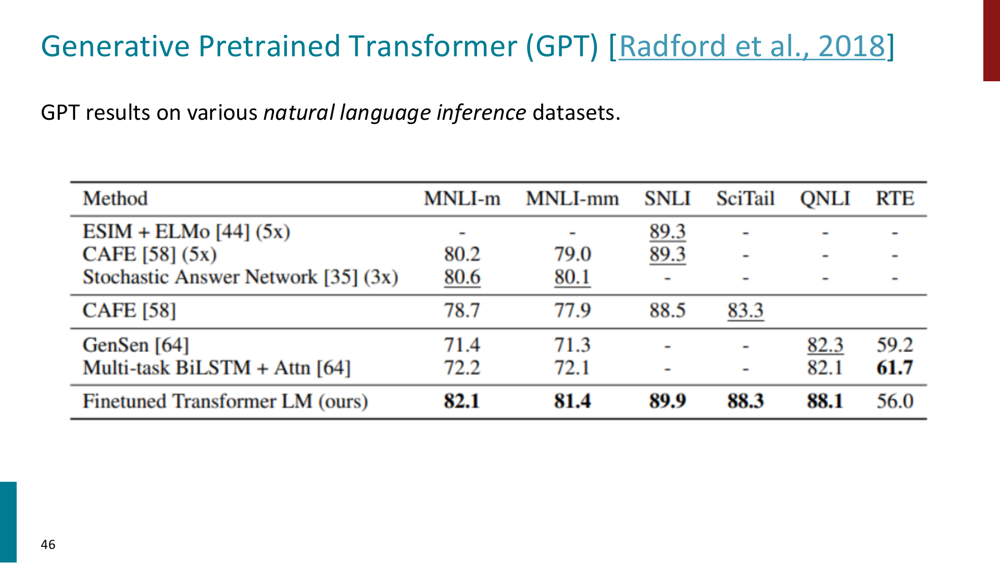

Stanford CS224N · supplied pretraining lecture · slide 46 (PDF p. 44) · <a href="https://cdn.openai.com/research-covers/language-unsupervised/language_understanding_paper.pdf">GPT paper</a>

::: {.notes}
Original reference slide, reproduced directly from the instructor-supplied PDF.
These are the original paper results reproduced by Stanford. Compare within columns; no new experimental results are claimed.

Accessible text from source:

Generative Pretrained Transformer (GPT) [Radford et al., 2018]
GPT results on various natural language inference datasets.

46
:::

## GPT-2: an actual generation {#stanford-gpt2-generation .stanford-source-slide}

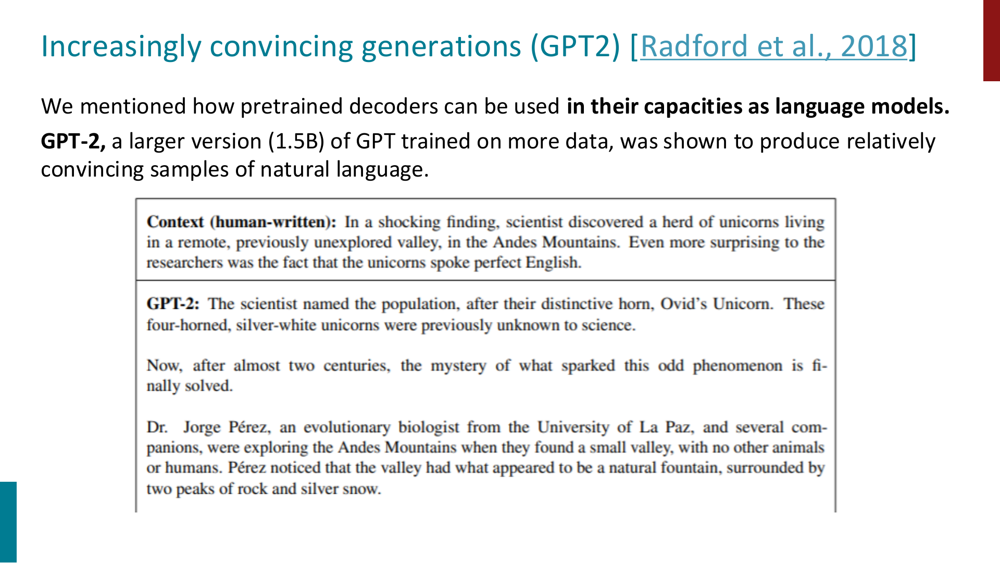

Stanford CS224N · supplied pretraining lecture · slide 47 (PDF p. 45) · <a href="https://cdn.openai.com/better-language-models/language_models_are_unsupervised_multitask_learners.pdf">GPT-2 paper (2019)</a>

Date correction: the GPT-2 paper is from 2019.

::: {.notes}
Original reference slide, reproduced directly from the instructor-supplied PDF.
Separate human-written prompt from model continuation. Ask what makes the continuation coherent, and why coherent generation does not establish factual truth.

Accessible text from source:

Increasingly convincing generations (GPT2) [Radford et al., 2018]
We mentioned how pretrained decoders can be used in their capacities as language models.
GPT-2, a larger version (1.5B) of GPT trained on more data, was shown to produce relatively
convincing samples of natural language.
:::

## GPT-3: learning from context {#stanford-gpt3 .stanford-source-slide}

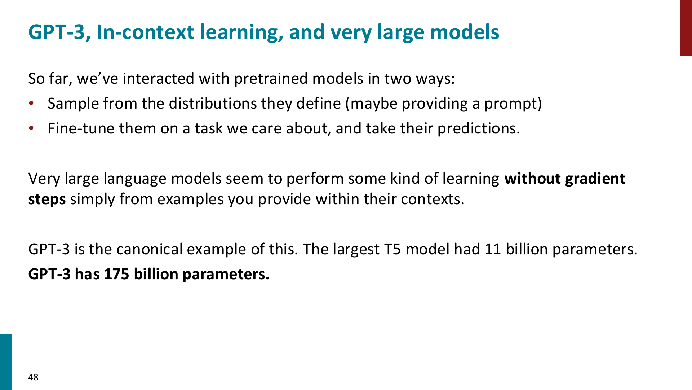

Stanford CS224N · supplied pretraining lecture · slide 48 (PDF p. 46) · <a href="https://arxiv.org/abs/2005.14165">GPT-3 paper</a>

::: {.notes}
Original reference slide, reproduced directly from the instructor-supplied PDF.
Present the original slide in its original sequence; retain its examples and research evidence.

Accessible text from source:

GPT-3, In-context learning, and very large models
So far, we’ve interacted with pretrained models in two ways:
• Sample from the distributions they define (maybe providing a prompt)
• Fine-tune them on a task we care about, and take their predictions.

Very large language models seem to perform some kind of learning without gradient
steps simply from examples you provide within their contexts.

GPT-3 is the canonical example of this. The largest T5 model had 11 billion parameters.
GPT-3 has 175 billion parameters.

48
:::

## GPT-3: the translation prompt {#stanford-gpt3-prompt .stanford-source-slide}

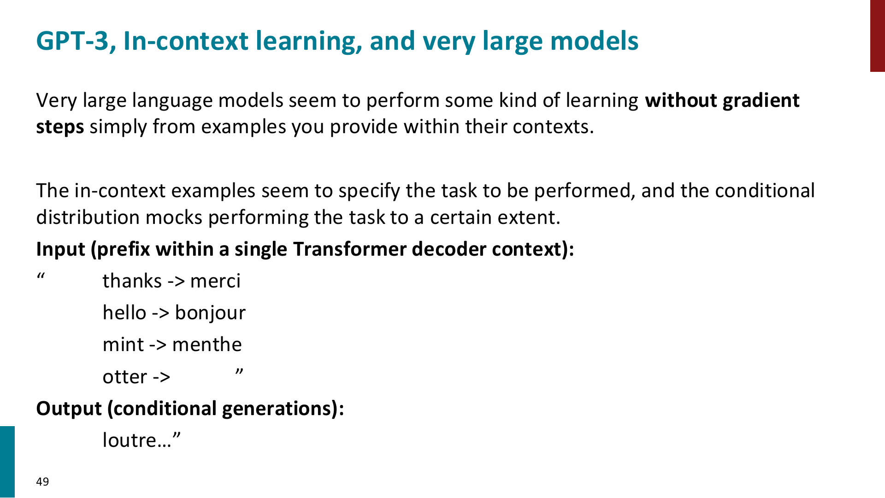

Stanford CS224N · supplied pretraining lecture · slide 49 (PDF p. 47) · <a href="https://arxiv.org/abs/2005.14165">GPT-3 paper</a>

::: {.notes}
Original reference slide, reproduced directly from the instructor-supplied PDF.
Present the original slide in its original sequence; retain its examples and research evidence.

Accessible text from source:

GPT-3, In-context learning, and very large models
Very large language models seem to perform some kind of learning without gradient
steps simply from examples you provide within their contexts.

The in-context examples seem to specify the task to be performed, and the conditional
distribution mocks performing the task to a certain extent.
Input (prefix within a single Transformer decoder context):
“       thanks -> merci
        hello -> bonjour
        mint -> menthe
        otter ->       ”
Output (conditional generations):
        loutre…”
49
:::

## GPT-3: pretraining and in-context learning {#stanford-gpt3-diagram .stanford-source-slide}

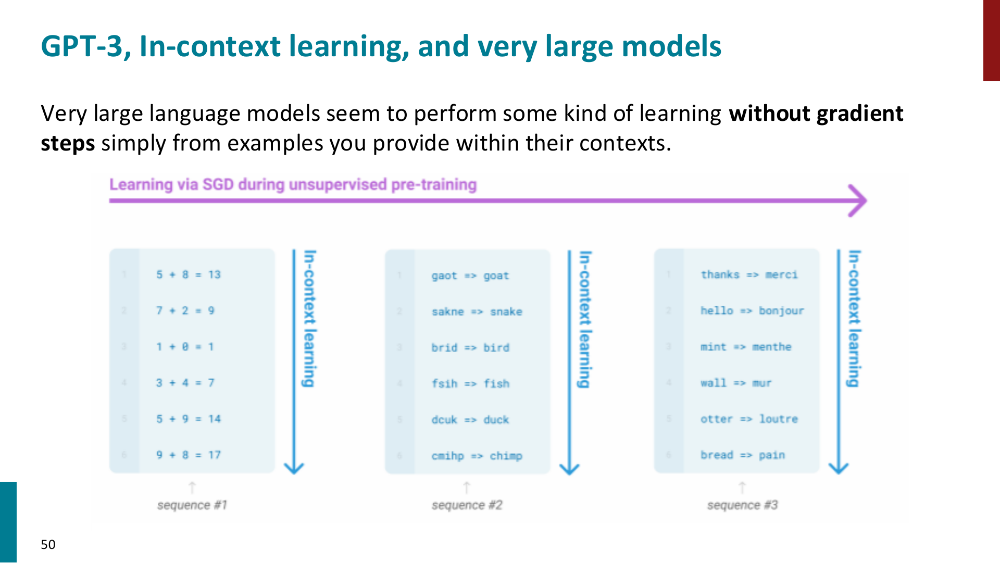

Stanford CS224N · supplied pretraining lecture · slide 50 (PDF p. 48) · <a href="https://arxiv.org/abs/2005.14165">GPT-3 paper</a>

::: {.notes}
Original reference slide, reproduced directly from the instructor-supplied PDF.
The horizontal arrow denotes parameter learning during pretraining; the vertical paths denote conditioning within a context. Do not imply gradient updates during in-context evaluation.

Accessible text from source:

GPT-3, In-context learning, and very large models
Very large language models seem to perform some kind of learning without gradient
steps simply from examples you provide within their contexts.

50
:::

## Why scale? Scaling laws {#stanford-scaling .stanford-source-slide}

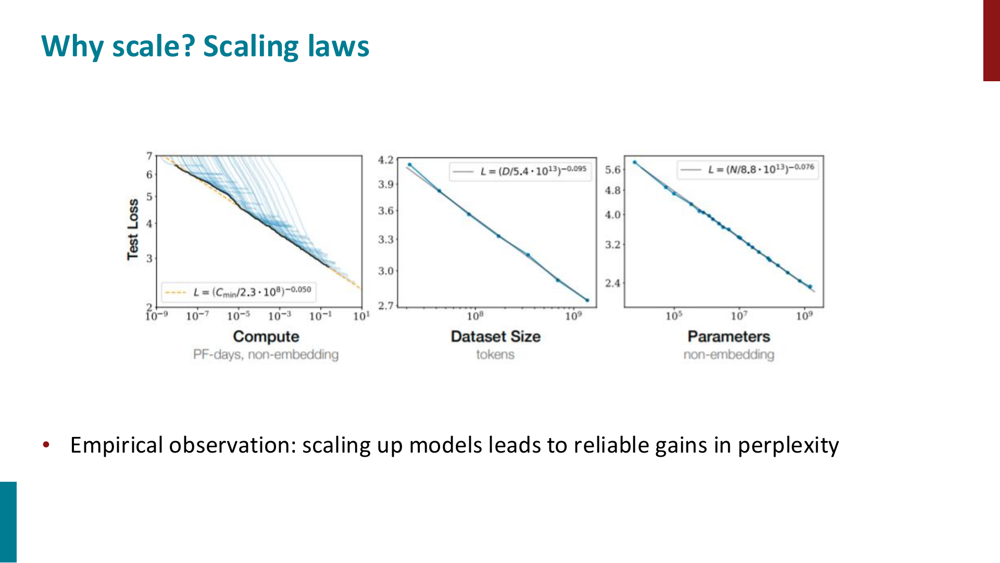

Stanford CS224N · supplied pretraining lecture · slide 51 (PDF p. 49) · <a href="https://arxiv.org/abs/2001.08361">Kaplan et al. (2020)</a>

::: {.notes}
Original reference slide, reproduced directly from the instructor-supplied PDF.
Read the axes before interpreting the curves. These are empirical fits in the paper’s experimental regime, not universal laws.

Accessible text from source:

Why scale? Scaling laws

• Empirical observation: scaling up models leads to reliable gains in perplexity
:::

## Model size and data tradeoffs {#stanford-size-data .stanford-source-slide}

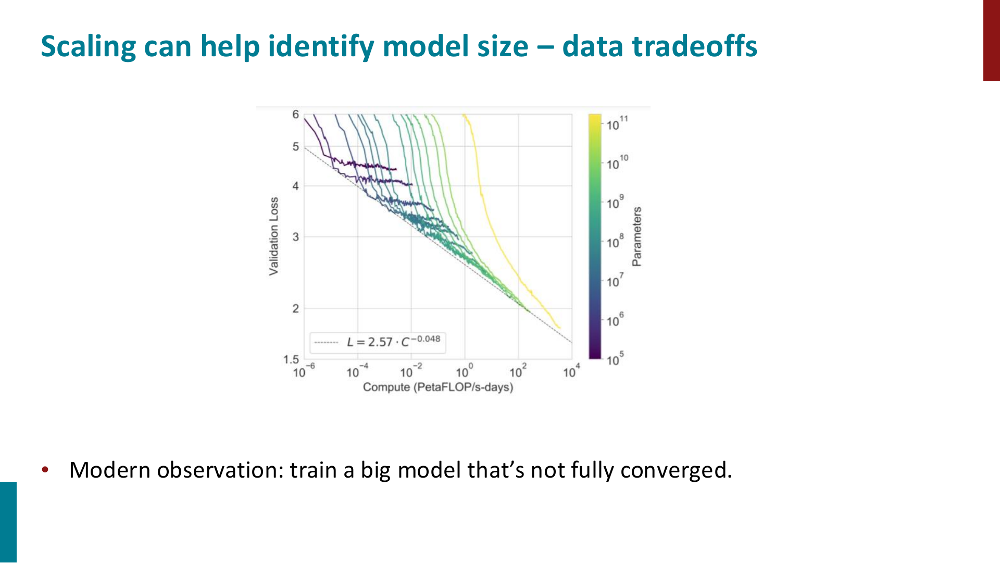

Stanford CS224N · supplied pretraining lecture · slide 52 (PDF p. 50) · <a href="https://arxiv.org/abs/2001.08361">Kaplan et al. (2020)</a>

Historical Kaplan (2020) recommendation; compare with the later Chinchilla result.

::: {.notes}
Original reference slide, reproduced directly from the instructor-supplied PDF.
The source says modern observation; date that claim to Kaplan et al. (2020). The following Chinchilla slide develops the later allocation result.

Accessible text from source:

Scaling can help identify model size – data tradeoffs

• Modern observation: train a big model that’s not fully converged.
:::

## Scaling and architecture decisions {#stanford-architecture .stanford-source-slide}

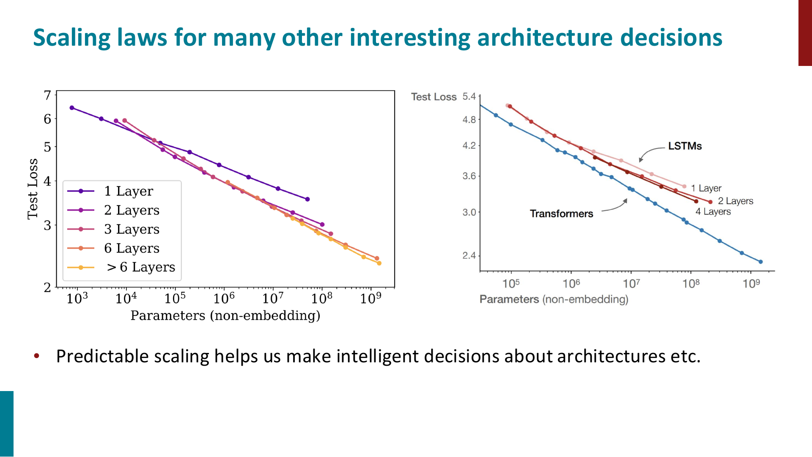

Stanford CS224N · supplied pretraining lecture · slide 53 (PDF p. 51) · <a href="https://arxiv.org/abs/2001.08361">Kaplan et al. (2020)</a>

::: {.notes}
Original reference slide, reproduced directly from the instructor-supplied PDF.
Present the original slide in its original sequence; retain its examples and research evidence.

Accessible text from source:

Scaling laws for many other interesting architecture decisions

• Predictable scaling helps us make intelligent decisions about architectures etc.
:::

## Compute efficiency: Chinchilla {#stanford-chinchilla .stanford-source-slide}

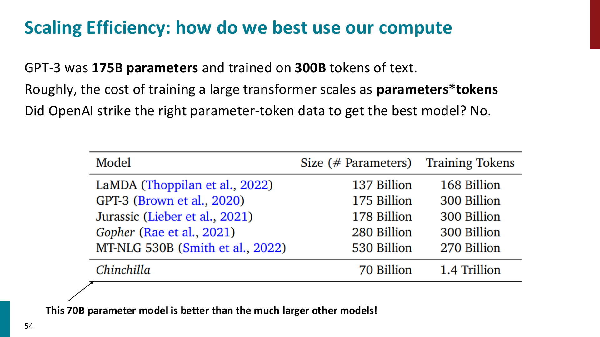

Stanford CS224N · supplied pretraining lecture · slide 54 (PDF p. 52) · <a href="https://arxiv.org/abs/2203.15556">Hoffmann et al. (2022)</a>

Chinchilla vs Gopher: same training-compute budget, 70B vs 280B parameters, 4× the training tokens.

::: {.notes}
Original reference slide, reproduced directly from the instructor-supplied PDF.
The parameter/token table alone is not a performance table. Hoffmann et al. support the performance comparison. Compare Chinchilla with Gopher at the same compute budget; not every model in this historical table has equal compute.

Accessible text from source:

Scaling Efficiency: how do we best use our compute
GPT-3 was 175B parameters and trained on 300B tokens of text.
Roughly, the cost of training a large transformer scales as parameters*tokens
Did OpenAI strike the right parameter-token data to get the best model? No.

     This 70B parameter model is better than the much larger other models!
54
:::

## Transition: what does pretraining teach? {#stanford-outline .stanford-source-slide}

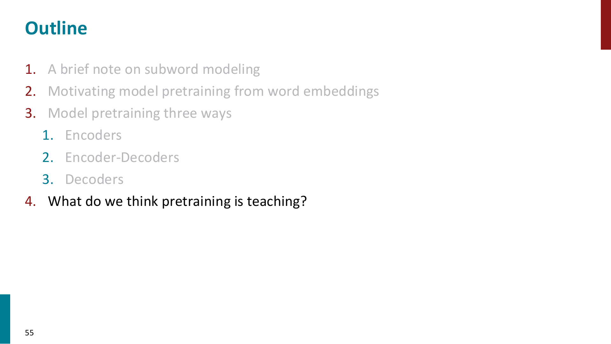

Stanford CS224N · supplied pretraining lecture · slide 55 (PDF p. 53)

::: {.notes}
Original reference slide, reproduced directly from the instructor-supplied PDF.
This is the original Stanford outline. Use it only as the transition to what pretraining teaches; do not suggest it is our course agenda.

Accessible text from source:

Outline
1. A brief note on subword modeling
2. Motivating model pretraining from word embeddings
3. Model pretraining three ways
  1. Encoders
  2. Encoder-Decoders
  3. Decoders
4. What do we think pretraining is teaching?

55
:::

## What does pretraining teach? {#stanford-capabilities .stanford-source-slide}

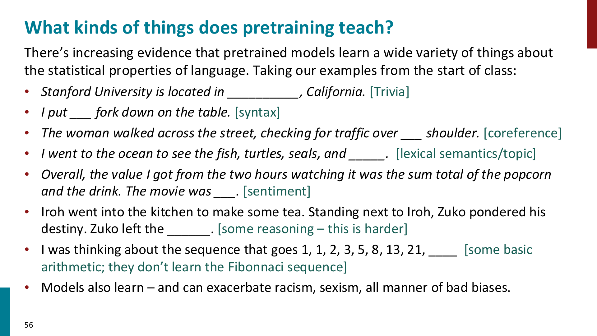

Stanford CS224N · supplied pretraining lecture · slide 56 (PDF p. 54)

::: {.notes}
Original reference slide, reproduced directly from the instructor-supplied PDF.
Present the original slide in its original sequence; retain its examples and research evidence.

Accessible text from source:

What kinds of things does pretraining teach?
There’s increasing evidence that pretrained models learn a wide variety of things about
the statistical properties of language. Taking our examples from the start of class:
• Stanford University is located in __________, California. [Trivia]
• I put ___ fork down on the table. [syntax]
• The woman walked across the street, checking for traffic over ___ shoulder. [coreference]
• I went to the ocean to see the fish, turtles, seals, and _____. [lexical semantics/topic]
• Overall, the value I got from the two hours watching it was the sum total of the popcorn
   and the drink. The movie was ___. [sentiment]
• Iroh went into the kitchen to make some tea. Standing next to Iroh, Zuko pondered his
   destiny. Zuko left the ______. [some reasoning – this is harder]
• I was thinking about the sequence that goes 1, 1, 2, 3, 5, 8, 13, 21, ____ [some basic
   arithmetic; they don’t learn the Fibonnaci sequence]
• Models also learn – and can exacerbate racism, sexism, all manner of bad biases.

56
:::

## Memorization and copyrighted material {#stanford-memorization .stanford-source-slide}

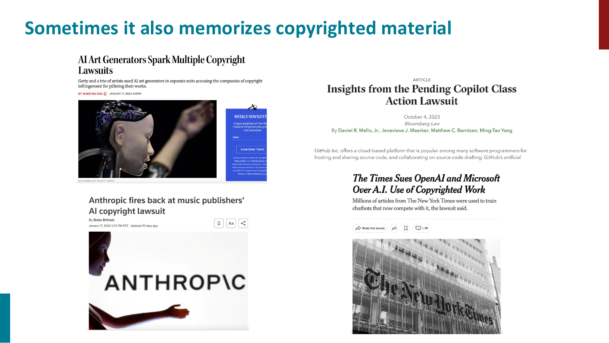

Stanford CS224N · supplied pretraining lecture · slide 57 (PDF p. 55)

Historical news screenshots from the supplied lecture; legal allegations are not findings.

::: {.notes}
Original reference slide, reproduced directly from the instructor-supplied PDF.
These are historical screenshots, not a legal update. They motivate discussion of memorization; lawsuits themselves do not establish measured extraction behavior or legal conclusions.

Accessible text from source:

Sometimes it also memorizes copyrighted material
:::

## Training-data extraction and privacy {#stanford-extraction .stanford-source-slide}

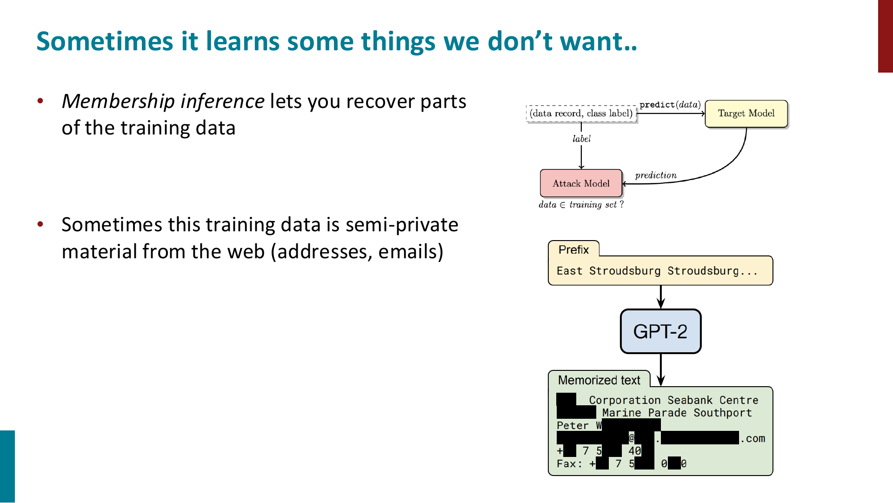

Stanford CS224N · supplied pretraining lecture · slide 58 (PDF p. 56) · <a href="https://arxiv.org/abs/2012.07805">Carlini et al. (2021)</a>

Distinguish membership inference (was an example in training?) from extraction (recover training text).

::: {.notes}
Original reference slide, reproduced directly from the instructor-supplied PDF.
The source combines two concepts. Membership inference tests whether data was used in training; training-data extraction recovers text. Carlini et al. demonstrate extraction. Closing question: how do we turn a capable text predictor into a reliable instruction-following assistant?

Accessible text from source:

Sometimes it learns some things we don’t want..
• Membership inference lets you recover parts
  of the training data

• Sometimes this training data is semi-private
  material from the web (addresses, emails)
:::
