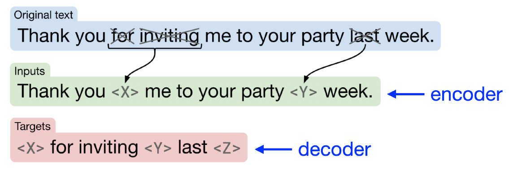

## T5: remove spans, keep the text as supervision {#t5-spans .t5-slide}

<p class="t5-lead">Our source: the <span class="t5-gap-a">cat sat</span> on the <span class="t5-gap-b">mat</span></p>
<p class="t5-caption">Two gaps: one contains two words, the other one word. The original text supplies both answers.</p>

{.t5-paper-figure fig-alt="T5 paper example as shown in Berkeley: Thank you for inviting me to your party last week becomes Thank you X me to your party Y week. The target is X for inviting Y last Z. One sentinel replaces the consecutive words for inviting."}

<p class="t5-takeaway"><strong>One gap → one sentinel.</strong><br>Reconstruct the missing spans in a separate output sequence.</p>
<p class="t5-caption">T5 = Text-to-Text Transfer Transformer · Recipe: 15% corrupted tokens; mean span length 3.</p>
<p class="s1-source">Raffel et al. (2020), Fig. 2, reproduced through Berkeley CS288, PDF p. 66; also shown in Stanford CS224N, PDF p. 36. Highlighted spans are handpicked examples, not measured outputs or a literal 15% sample.</p>

::: {.notes}
TIME: 3 minutes. Continue from GPT's two-stream question. Students already know
encoder–decoder attention and AR prediction. Do not explain Transformer blocks
again. Begin with our existing cat sentence; extend its first gap to cat sat so
students see that a span may contain more than one token. The spans are contiguous
regions. What they contain is known while constructing the training pair.

Now read the published figure's original text, corrupted input, and target.
The consecutive words for inviting are removed together and replaced by X;
last is replaced by Y. The target retains the removed words in their source
order. Z closes the final span in the paper's representation. X/Y/Z are distinct
special tokens, not literal unknown words and not repeated MASK tokens.
The next slide maps these markers to our example and to T5 sentinel names.

This figure is cropped from the Berkeley lecture, which reproduces T5 Figure 2.
Stanford p.36 uses the same construction with a source/target architecture view.
Neither its number of missing words nor ours is a representative masking rate.
The final recipe uses a 15% noise density and mean span length 3, over tokenized
text. These are corpus-level recipe settings, not proportions our tiny example
must match. No calculations are requested here.

The original text supplies both source and target; no translator or sentiment
annotator is needed for this reconstruction task. Explain why this is pretraining:
repeating it across a corpus learns parameters we can reuse. Transition: “What
exactly goes into the encoder, and what exactly is the decoder trained to output?”
:::

## Inspect the source and the reconstruction target {#t5-construction .t5-slide .s1-slide}

<div class="lab-toolbar t5-toolbar" role="group" aria-label="Choose spans for the teaching example"><button type="button" data-t5-spans="single" aria-pressed="true">Gaps: cat / mat</button><button type="button" data-t5-spans="long" aria-pressed="false">Extend first gap: cat sat / mat</button></div>
<div class="t5-original"><span class="lab-label">ORIGINAL · SAME SIX WORDS</span><p id="t5-original">the <mark class="t5-gap-a">cat</mark> sat on the <mark class="t5-gap-b">mat</mark></p></div>
<div class="t5-stream t5-source-stream"><span class="lab-label">ENCODER INPUT · x̃</span><div id="t5-source-tokens" class="t5-token-row" aria-live="polite"></div></div>
<div class="t5-stream t5-target-stream"><span class="lab-label">DECODER TARGET · y</span><div id="t5-target-tokens" class="t5-token-row" aria-live="polite"></div></div>
<p id="t5-construction-note" class="t5-takeaway" aria-live="polite">S₀ marks the first gap; S₁ the second. S₂ closes the final span.</p>
<p class="t5-token-key">S₀ / S₁ / S₂ abbreviate <code>&lt;extra_id_0&gt;</code> / <code>&lt;extra_id_1&gt;</code> / <code>&lt;extra_id_2&gt;</code>.<br>EOS ends a sequence; it is different from a sentinel.</p>
<p class="s1-source">Reuses the preserved <code>#seq2seq-recipe</code> and its multiword extension. Paper-style sentinel construction; boundary EOS tokens shown explicitly. Word-level teaching notation, not a tokenizer trace or model run.</p>

::: {.notes}
TIME: 4 minutes. Begin with the old draft's one-word gaps: cat and mat. Read the
encoder input and target as separate objects. S0 in the source marks where the
first span was removed; S0 in the target introduces that span's content. The same
is true for S1. S2 is an additional final sentinel in the paper's Figure 2 target
convention; it does not mark a third missing span in the source. EOS is a separate
sequence terminator. We explicitly append EOS on both streams in this schematic.

Click Extend first gap. Only the missing first span grows: cat sat replaces cat
in the target, while sat disappears from the source. There is still just one S0
in each stream and two gaps total. That is the mechanism to inspect, not an
animation of a model predicting. The script constructs two hand-authored examples
and never calls a tokenizer, model, or optimizer. The six words are pedagogical
units; actual T5 uses SentencePiece tokenization. Visible sentinel abbreviations
stand for single special vocabulary IDs, not strings split into ordinary letters.

Do not equate sentinels with BERT's uniform MASK replacement: sentinels identify
different gaps within an example. Nor is this a full-source autoencoder target:
uncorrupted words are absent from the output. The synthetic short output need not
be shorter than the input once boundary tokens are included. Length savings are
motivated by long sequences with a relatively small corrupted fraction.

Return the control to Gaps: cat / mat before advancing. The loss slide fixes that
case so students can trace exactly the same targets. Transition: “Which of these
output tokens receives loss, and can that loss train the encoder too?”
:::

## A reconstruction loss trains both stacks {#t5-loss .t5-slide}

<p class="t5-fixed-source"><span>FIXED SOURCE · ONE-WORD GAPS</span>the S₀ sat on the S₁ EOS</p>
<table class="t5-loss-table"><tbody><tr><th>Decoder input</th><td>START</td><td>S₀</td><td>cat</td><td>S₁</td><td>mat</td><td>S₂</td></tr><tr class="t5-scored"><th>Scored target</th><td>S₀</td><td>cat</td><td>S₁</td><td>mat</td><td>S₂</td><td>EOS</td></tr></tbody></table>

```{=html}
<svg class="t5-gradient-diagram" viewBox="0 0 1320 235" role="img" aria-label="The encoder's source states enter the decoder through cross-attention. The decoder vocabulary head yields a reconstruction loss. Backpropagation from that loss trains the head, decoder, and encoder.">
<defs><marker id="t5-forward" viewBox="0 0 10 10" refX="9" refY="5" markerWidth="7" markerHeight="7" orient="auto"><path d="M0 0L10 5L0 10Z" fill="#0f7881"/></marker><marker id="t5-back" viewBox="0 0 10 10" refX="9" refY="5" markerWidth="7" markerHeight="7" orient="auto"><path d="M0 0L10 5L0 10Z" fill="#a34832"/></marker></defs>
<g font-family="sans-serif" fill="#17364a" text-anchor="middle"><rect x="30" y="30" width="310" height="90" rx="12" fill="#dfece6"/><text x="185" y="85" font-size="30">Encoder</text><rect x="560" y="30" width="310" height="90" rx="12" fill="#e3eaf0"/><text x="715" y="85" font-size="30">Decoder + head</text><rect x="1050" y="30" width="235" height="90" rx="12" fill="#f5e4c6"/><text x="1167" y="85" font-size="30">Loss</text>
<path d="M350 75H550M880 75H1040" stroke="#0f7881" stroke-width="3" fill="none" marker-end="url(#t5-forward)"/><text x="450" y="28" font-size="22">source states</text><text x="450" y="115" font-size="22">cross-attention</text><text x="960" y="28" font-size="22">scores</text>
<path class="t5-gradient" d="M1167 130V182H745V130"/><path class="t5-gradient" d="M685 130V182H185V130"/><text x="650" y="225" font-size="26" fill="#a34832">Gradients train the encoder, decoder, embeddings, and head.</text></g></svg>
```

<div class="t5-objective">

$$\mathcal{L}_{\mathrm{T5}}(\theta)=-\frac{1}{6}\sum_{t=1}^{6}\log p_\theta(y_t\mid y_{<t},\widetilde{x})$$

</div>
<p class="t5-takeaway">Score <strong>every non-padding target token</strong>: missing content, sentinels, and EOS.</p>
<p class="s1-source">Conditional cross-entropy for the displayed paper-style example; no numerical exercise. START is the decoder initialization symbol (original T5 uses its pad-token ID). Source tokens have no separate direct reconstruction-loss terms.</p>

::: {.notes}
TIME: 4 minutes. Reuses the old #seq2seq-loss alignment, with boundaries made
explicit. Students know teacher forcing and causal decoding; point to the rows
only to identify what the PRETRAINING loss supervises. Six targets are present:
S0, cat, S1, mat, S2, EOS. Sentinels and EOS are targets too, not formatting ignored
by training. START is not a target in this table. We omit batch padding; padded
labels would be ignored. T5's decoder start uses its configured pad-token ID;
its role here is initialization, not a request to drop the first valid prediction.

The fixed source includes its own EOS, but those encoder inputs do not receive
independent decoder loss terms. Loss compares the decoder distributions with y.
The formula conditions each target on the earlier target prefix AND the source.
No new probability derivation or arithmetic is needed. Each symbol stays tied
to the table; the divisor 6 is the number of displayed non-padding target tokens.
In batching, normalization may instead average across all valid target tokens.

Follow the solid path from encoder memory through cross-attention to the decoder
head and loss. Then follow the gradient path back. The encoder learns because
its outputs influence the decoder loss, even without an encoder prediction head.
All trainable backbone and embedding parameters participate in pretraining;
shared embeddings remain shared parameters. The SVG abstracts the dependency,
not the full computation graph or measured gradient magnitudes. It does not
suggest that gradients bypass the decoder on their way to the encoder.

The vocabulary target is the original removed content, not a model-generated
answer judged by another model. Transition: “What stays the same when we reuse
these parameters for a task whose target is not missing corpus text?”
:::

## Reuse the weights and the text-to-text interface {#t5-transfer .t5-slide}

<p class="t5-lead">A task changes the input and target text. The encoder–decoder interface stays familiar.</p>
<table class="t5-task-table"><thead><tr><th>Stage / task</th><th>Input text</th><th>Target text</th></tr></thead><tbody><tr><th>Span pretraining</th><td>the S₀ sat on the S₁</td><td>S₀ cat S₁ mat S₂</td></tr><tr><th>Sentiment adaptation</th><td>sst2 sentence: I loved this film.</td><td>positive</td></tr><tr><th>Translation adaptation</th><td>translate English to French: The cat sleeps.</td><td>Le chat dort.</td></tr></tbody></table>
<div class="t5-transfer-route"><div><span>PRETRAIN ON CORPUS TEXT</span><strong>Learn encoder–decoder weights</strong></div><b aria-hidden="true">→</b><div><span>ADAPT WITH TASK EXAMPLES</span><strong>Initialize from those same weights</strong></div></div>
<p class="t5-takeaway">The <strong>source of supervision changes</strong>: removed corpus text → task labels or paired texts.</p>
<p class="s1-source"><a href="https://jmlr.org/papers/v21/20-074.html">Raffel et al. (2020), §2.4 and Fig. 1</a>. Authored input/target examples, not model predictions. Boundary EOS omitted in this interface table. Detailed adaptation follows in Session 2.</p>

::: {.notes}
TIME: 3 minutes. T5 expands to Text-to-Text Transfer Transformer. The interface
handles text classification by generating a textual class label, rather than
requiring a separate label-vector head in the teaching example. Translation uses
paired source/target texts. These are examples of task formatting and supervision,
not claims that span reconstruction alone produces competent sentiment analysis
or translation. The generated label must still be interpreted/evaluated as a
classification output, but defer those implementation details.

The sentiment prefix uses the original T5 SST-2 task convention; prefixes are
learned task cues in the corresponding supervised setup, not magic instructions.
Do not confuse task-prefixed supervised examples with zero-shot prompting. The
English/French pair and sentiment example are authored to make the target source
visible. Neither output was obtained from a model. Real task fine-tuning uses
many labeled examples, and full fine-tuning updates the transferred parameters.

Our diagram isolates the general pretrain-then-adapt workflow. The original paper
also studied multitask mixtures; do not present this teaching flow as an exhaustive
account of every released T5 variant's training mixture. The insight is that the
same text-to-text machinery accommodates a new supervision source. Leave details
of fine-tuning, frozen weights, and prompting to Session 2.
Transition: “We now have three pretraining recipes. What exactly differs among them?”
:::

## Three recipes. One question about learned weights. {#t5-synthesis-bridge .t5-slide}

<p class="t5-lead">T5 recap: corrupted source → missing-span targets → learned encoder–decoder parameters.</p>

```{=html}
<svg class="t5-bridge-diagram" viewBox="0 0 1320 480" role="img" aria-label="The same corpus sentence branches into BERT, GPT, and T5 training recipes. Each route leads to its own learned checkpoint. A question asks students to compare their supervision and reusable parameters in the next section.">
<defs><marker id="t5-bridge-arrow" viewBox="0 0 10 10" refX="9" refY="5" markerWidth="7" markerHeight="7" orient="auto"><path d="M0 0L10 5L0 10Z" fill="#0f7881"/></marker></defs>
<g font-family="sans-serif" fill="#17364a" text-anchor="middle"><rect x="250" y="20" width="820" height="85" rx="12" fill="#e7ece5"/><text x="660" y="74" font-size="38">the cat sat on the mat</text>
<path class="t5-bridge-flow" d="M660 115V150H230V200"/><path class="t5-bridge-flow" d="M660 115V200"/><path class="t5-bridge-flow" d="M660 115V150H1090V200"/>
<rect x="50" y="215" width="360" height="105" rx="12" fill="#dfece6"/><text x="230" y="281" font-size="39">BERT</text><rect x="480" y="215" width="360" height="105" rx="12" fill="#f4e4d6"/><text x="660" y="281" font-size="39">GPT</text><rect x="910" y="215" width="360" height="105" rx="12" fill="#dde8f0"/><text x="1090" y="281" font-size="39">T5</text>
<path class="t5-bridge-flow" d="M230 330V375"/><path class="t5-bridge-flow" d="M660 330V375"/><path class="t5-bridge-flow" d="M1090 330V375"/>
<text x="230" y="422" font-size="29">learned checkpoint</text><text x="660" y="422" font-size="29">learned checkpoint</text><text x="1090" y="422" font-size="29">learned checkpoint</text><text x="660" y="474" font-size="24">Different training signals; separate parameter sets.</text></g></svg>
```

<p class="t5-question">What does each recipe teach the model to recover—and what weights can we reuse?</p>
<p class="s1-source">Original conceptual bridge. It previews the remaining Session 1 comparison; it does not imply that the three models share weights or have interchangeable objectives.</p>

::: {.notes}
TIME: 1 minute. Complete the four-minute reuse block with this compact synthesis
and forward question. T5's corrupted source and missing-span targets train an
encoder–decoder that can later be adapted through text-to-text supervision.

The same corpus can supply different training targets. Trace the three separate
routes; each ends in its own learned parameter set. Motion represents training
information flow, not actual updates or benchmark results. Do not fill in the
full BERT/GPT/T5 comparison here. That is the next requested 15-minute synthesis,
which will ask students to construct and compare the recipes themselves.

End with the displayed question and stop for instructor review. Session 1's final
bridge toward sentiment adaptation is still to come after that synthesis; this
is a section bridge, not the finished lecture ending.
:::
