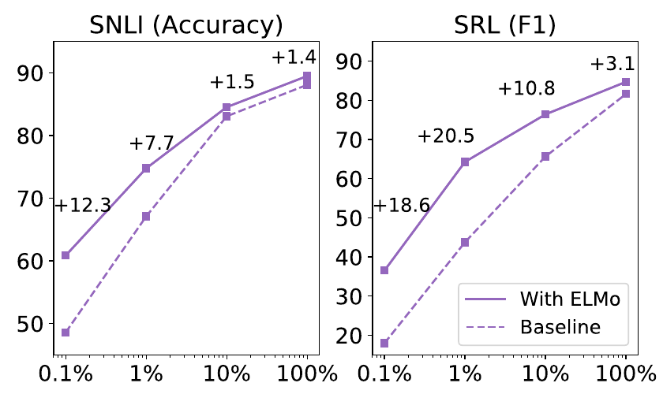
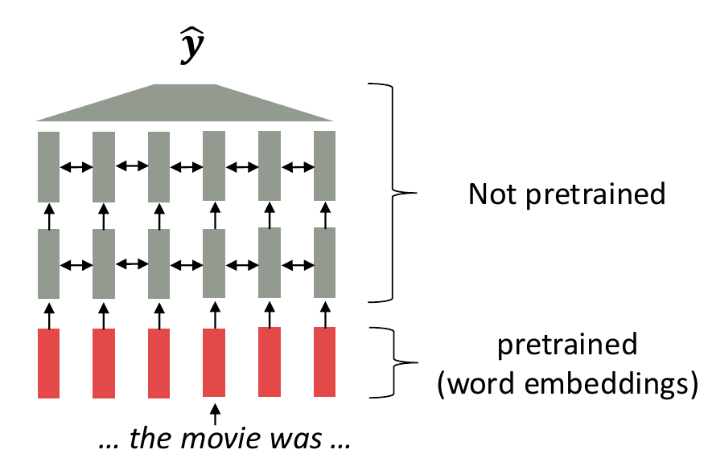
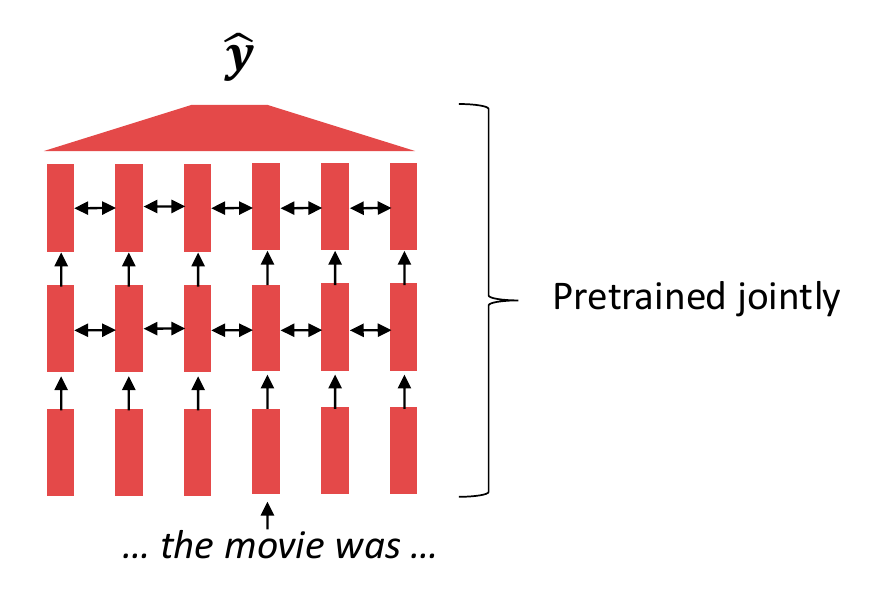
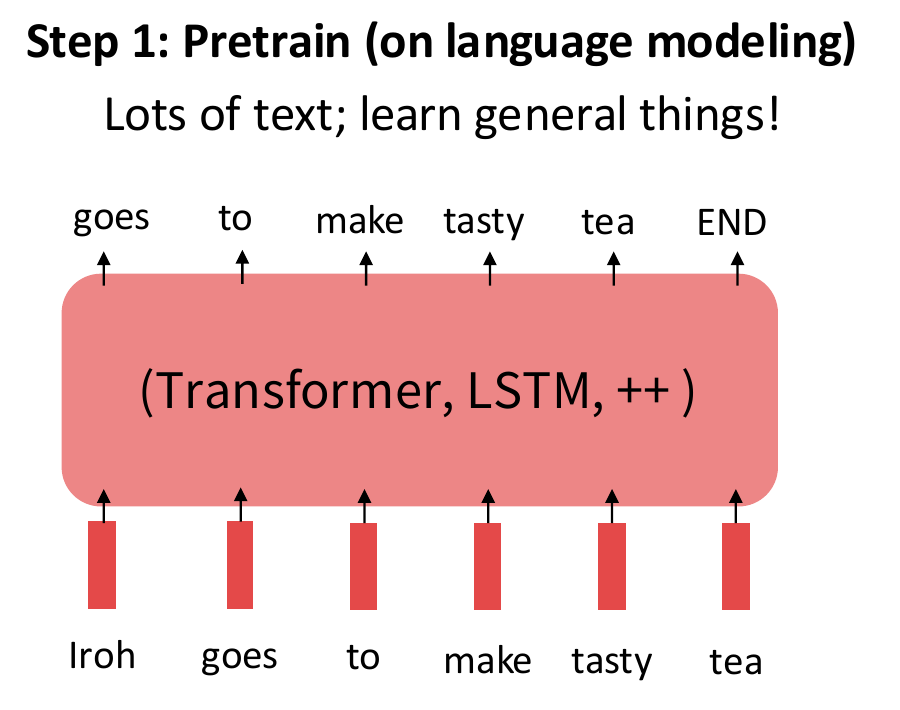
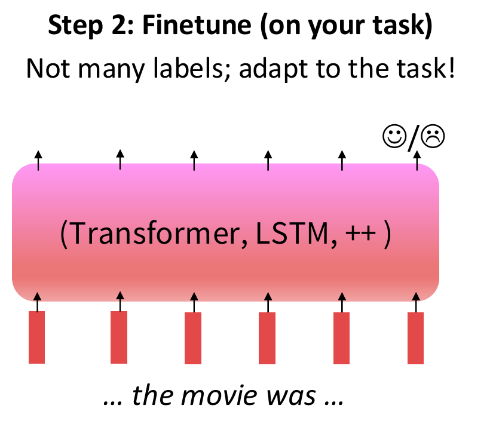

## A Transformer is a starting architecture {#why-pretrain .why-slide .why-architecture}

<p class="why-eyebrow">01 · WHY PRETRAIN? <span>Architecture ≠ learned parameters</span></p>
<p class="why-review">“I loved this movie.”</p>

```{=html}
<svg class="why-network" viewBox="0 0 1320 330" role="img" aria-label="A token sequence enters a newly initialized Transformer, then a new sentiment head. The prediction is unknown; the training label is positive.">
<defs><marker id="why-arrow" markerWidth="9" markerHeight="9" refX="8" refY="4" orient="auto"><path d="M0,0 L8,4 L0,8" fill="none" stroke="#17364a" stroke-width="1.5"/></marker></defs>
<g fill="#17364a" font-family="sans-serif" text-anchor="middle">
<text x="125" y="55" font-size="24">INPUT TOKENS</text>
<rect x="20" y="85" width="210" height="155" rx="12" fill="#e4eeed"/>
<text x="125" y="133" font-size="31">I · loved</text><text x="125" y="186" font-size="31">this · movie</text>
<path d="M245 160 H325" stroke="#17364a" stroke-width="4" marker-end="url(#why-arrow)"/>
<rect x="350" y="60" width="380" height="205" rx="15" fill="#e8e5dd" stroke="#87918c" stroke-width="2"/>
<text x="540" y="112" font-size="32" font-weight="bold">Transformer</text>
<g fill="none" stroke="#aab3af" stroke-width="2"><path d="M415 155L465 195 515 155 565 195 615 155 665 195M415 195L465 155 515 195 565 155 615 195 665 155"/></g>
<g fill="#87918c"><circle cx="415" cy="155" r="8"/><circle cx="465" cy="195" r="8"/><circle cx="515" cy="155" r="8"/><circle cx="565" cy="195" r="8"/><circle cx="615" cy="155" r="8"/><circle cx="665" cy="195" r="8"/></g>
<text x="540" y="305" font-size="24">random initial weights</text>
<path d="M748 160 H828" stroke="#17364a" stroke-width="4" marker-end="url(#why-arrow)"/>
<rect x="850" y="95" width="210" height="130" rx="12" fill="#f3e7cc"/>
<text x="955" y="148" font-size="29">Sentiment</text><text x="955" y="188" font-size="29">head</text>
<path d="M1077 160 H1150" stroke="#17364a" stroke-width="4" marker-end="url(#why-arrow)"/>
<text x="1220" y="180" font-size="75">?</text>
<text x="1220" y="252" font-size="24">prediction</text>
</g></svg>
<div class="why-label-line"><span>SUPPLIED TRAINING LABEL</span><strong>positive</strong></div>
<div class="why-bottom fragment"><strong>Our labeled reviews must do two jobs.</strong><p>Teach the model to interpret language—and to make the sentiment decision.</p></div>
```

<p class="why-source">Motivation: Stanford CS224N, pretraining lecture, PDF p. 10. Original schematic; no model prediction is shown.</p>

::: {.notes}
TIME: 2 minutes. Begin with the sentence, not a definition of pretraining. Ask:
“What should the sentiment label be?” Then trace input, Transformer, head, output.
The question mark is deliberate: a newly initialized model has no reason to
produce the desired label. Positive is the supplied annotation, not its output.

Connect to Lecture 07: the architecture specifies a computation; the numerical
parameters still need learning. In this from-scratch setup, the embedding table,
contextual layers, and task head all start untrained. The small graph inside the
box is symbolic, not a Transformer layer diagram or measured attention.

Reveal the final statement. A modest labeled dataset must provide evidence for
both language-sensitive features and the task decision. This is not a proof that
training from scratch never works; it motivates a reusable starting point.
Transition: “We already know one way to borrow something learned from text:
pretrained word embeddings. What do they give us, and what is still missing?”
:::

## One word type, one lookup vector {#static-bank .why-slide .why-static}

<p class="why-eyebrow">RECALL WORD2VEC <span>Learned from text before the task</span></p>

```{=html}
<div class="why-sentence-pair">
<div><span class="why-context-label">MONEY CONTEXT</span><p>She deposited money at the <mark>bank</mark>.</p></div>
<div><span class="why-context-label">RIVER CONTEXT</span><p>She sat beside the river <mark>bank</mark>.</p></div>
</div>
<div class="why-lookup">
<div class="why-word">bank</div><span class="why-big-arrow" aria-hidden="true">→</span>
<div><span class="why-context-label">THE SAME LOOKUP IN BOTH SENTENCES</span><div class="why-vector" role="img" aria-label="One fixed word vector, shown as six illustrative colored cells"><i></i><i></i><i></i><i></i><i></i><i></i></div><p class="why-vector-label">e(bank)</p></div>
</div>
<p class="why-statement">The lookup knows the <strong>word</strong>.<br>It does not receive the <strong>sentence</strong>.</p>
```

<p class="why-source">Content: Berkeley CS288, PDF pp. 4–6; Stanford CS224N, p. 9. Original bank example. Vector colors are schematic, not measured values.</p>

::: {.notes}
TIME: 3 minutes. Brief retrieval of Word2Vec: it learned a table of word vectors
from prediction tasks constructed from text. Do not reteach skip-gram or its loss.
Read the two sentences and ask students to identify the two senses of bank.
Point to the single lookup row: the word type selects the same parameters in
both contexts. The six colored cells are a visual symbol for a vector, not a
six-dimensional Word2Vec measurement or interpretable semantic axes.

Important distinction: a model USING static embeddings can still distinguish
the two meanings through its later contextual layers. We are locating what the
lookup itself does, not claiming that Word2Vec-based systems cannot use context.
The surrounding network still has to learn how to interpret these vectors in
sentences. This follows Berkeley's Word2Vec limitation discussion and Stanford's
contextual-meaning motivation. Transition: “Could the representation we reuse
already depend on the sentence?”
:::

## Same word. Different surrounding evidence. {#contextual-bank .why-slide .why-contextual}

<div class="why-context-toolbar" role="group" aria-label="Choose the context for bank"><button type="button" data-why-context="money" aria-pressed="true">Money context</button><button type="button" data-why-context="river" aria-pressed="false">River context</button><span>Same model · fixed weights</span></div>
<p class="why-context-sentence" aria-live="polite"><span id="why-prefix">She deposited money at the </span><mark>bank</mark>.</p>

```{=html}
<div class="why-context-flow">
<div class="why-context-input"><span class="why-context-label">WORD LOOKUP</span><div class="why-vector" role="img" aria-label="The bank lookup vector stays the same"><i></i><i></i><i></i><i></i><i></i><i></i></div><p>e(bank) stays the same</p></div>
<div class="why-context-model"><span class="why-context-label">WHOLE SENTENCE ENTERS</span><strong>Contextual<br>model</strong><span class="why-context-connector" aria-hidden="true">→</span></div>
<div class="why-context-output"><span class="why-context-label">BANK’S OUTPUT STATE</span><div id="why-context-vector" class="why-vector why-vector-context" role="img" aria-label="Context-dependent output vector; schematic"><i></i><i></i><i></i><i></i><i></i><i></i></div><p>h(bank | sentence) can change</p></div>
</div>
<div class="why-context-question"><span>DISCUSS</span><p>A financial use of “bank” should resemble which context?<br>What would we need to measure to check that?</p></div>
<p class="why-context-history"><strong>Next: ELMo.</strong> An early example of making contextual representations reusable.</p>
```

<p class="why-source">Adapted teaching example: Berkeley CS288, pp. 6–8, 10–16; Peters et al. (2018), <a href="https://aclanthology.org/N18-1202/">ELMo</a>. Schematic vectors: switching context illustrates dependence, not measured sense recognition.</p>

::: {.notes}
TIME: 2 minutes. Switch between money and river while students watch the word
lookup and output. The word and model parameters are fixed; the surrounding
tokens change. The left vector remains identical; the right symbol changes.
This is an explanatory interaction, not inference. Do not describe its chosen
colors as experimental evidence that a model distinguishes senses.

The final state at a token position depends on the contextual computation. Write
or read h(bank | sentence) as “the representation of bank in this sentence.”
Contextual does not itself mean pretrained: an untrained contextual network can
also produce different outputs. Pretraining aims to make the representations
USEFUL. To test meaning, we would compare actual representations or downstream
behavior across many examples; no cosine calculation is needed here.

The discussion adapts Berkeley p.8's play-in-different-contexts exercise. Ask for
the expected financial-context match, then distinguish that expectation from a
measurement. Transition: “ELMo made this idea concrete: contextual representations
could be learned in advance and then supplied to another task model.” The next
slide defines the name and gives a brief empirical example.
:::

## ELMo: contextual features we can reuse {#elmo .why-slide .why-elmo}

<p class="elmo-name"><strong>E</strong>mbeddings from <strong>L</strong>anguage <strong>Mo</strong>dels <span>· Peters et al., 2018</span></p>

```{=html}
<div class="elmo-layout">
<div class="elmo-definition">
<p class="elmo-definition-lead">A word representation built from the internal states of pretrained <strong>forward and backward LSTM language models</strong>.</p>
<div class="elmo-reading"><span>left context →</span><mark>word</mark><span>← right context</span></div>
<p>Mix their layer representations to give each word a vector that depends on its sentence.</p>
<p class="elmo-reuse"><strong>Reuse as features:</strong> keep the language-model weights fixed while training the task model and the layer mixture.</p>
</div>
<figure class="elmo-evidence">
<figcaption>Do pretrained features help with fewer labels?</figcaption>

<p class="elmo-chart-key"><strong>Horizontal:</strong> fraction of labeled task-training data.<br><strong>Vertical:</strong> SNLI accuracy / SRL F1 (higher is better).</p>
<p class="elmo-chart-takeaway">Larger gains when task labels are scarce.</p>
</figure>
</div>
<p class="why-statement why-compact">The language model supplies features.<br>The downstream model still learns its own task.</p>
```

<p class="why-source">Peters et al. (2018), <a href="https://aclanthology.org/N18-1202/">Deep Contextualized Word Representations</a>, §§3.1–3.3, 5.4 and Figure 1 (PDF p. 8). Original published curves, not classroom runs. SNLI: sentence-pair inference; SRL: semantic role labeling.</p>

::: {.notes}
TIME: 1 minute, taken from the preceding context comparison; the section remains
15 minutes. Expand ELMo aloud: Embeddings from Language Models. It uses LSTMs,
not Transformers. The forward model uses preceding words and the backward model
uses following words. Their hidden states and the context-independent token
representation are mixed with learned task-specific weights. The diagram is a
conceptual summary; it is not a bidirectional prediction model allowed to see the
answer during language-model pretraining.

Explain the feature-based setup in one sentence: hold the pretrained language
model fixed while learning how to combine its representations and how to solve
the downstream task. The paper also describes optional domain adaptation of the
language model before downstream use; “fixed” here refers to supervised task
training in §3.3, not a ban on every possible later language-model update.

Read Figure 1: x is the percentage of the labeled task training set, on a log
scale. It does not mean that the language model was pretrained on only 0.1% of
its corpus. Left: SNLI sentence-pair inference accuracy. Right: semantic role
labeling F1, identifying who did what to whom. These are different metrics, so do
not compare their absolute heights across panels. Solid is with ELMo, dashed is
the task baseline. Both curves improve as task data increases; ELMo's advantage
is larger in the smaller-data conditions. The paper discusses these experiments
in §5.4; the figure itself does not label the evaluation split, so do not invent
a test/dev designation. No confidence intervals are shown.

This supports the value of contextual features for these tasks and settings,
not a guarantee for every model or dataset. Keep the plot discussion brief; no
loss, mixture-weight equation, or benchmark survey is needed. Transition:
“ELMo reuses contextual features. The next step is to reuse the contextual model
itself as the starting point for task-specific training.”
:::

## Give the whole model a head start {#whole-model-pretraining .why-slide .why-source-compare}

<p class="why-eyebrow">WHAT IS ALREADY LEARNED BEFORE THE TASK?</p>

```{=html}
<div class="why-source-pair">
<figure><figcaption><span>EARLIER STARTING POINT</span><strong>Pretrained word embeddings</strong></figcaption><p>The contextual layers still start from random weights.</p></figure>
<figure><figcaption><span>WHOLE-MODEL PRETRAINING</span><strong>Pretrained contextual layers too</strong></figcaption><p>The task starts from a model already trained on text.</p></figure>
</div>
<div class="why-source-key"><span><i class="why-red"></i> Learned during pretraining</span><span><i class="why-gray"></i> Not yet pretrained</span></div>
<p class="why-statement why-compact">Reuse the contextual model’s <strong>parameters</strong>.<br>A new task-specific head may still be initialized from scratch.</p>
```

<p class="why-source">Figures reproduced from Diyi Yang, Stanford CS224N (2026), pretraining lecture, PDF pp. 10–11. Original colors retained; these are schematic networks.</p>

::: {.notes}
TIME: 3 minutes. Use the real source drawings as the central evidence of the
conceptual change. First explain the color key. Trace the red lookup row into the
gray contextual layers on the left, then repeat the trace on the right.
The difference is which parameter groups have a pretrained initialization.
Neither drawing says those weights must remain frozen during task training.

Stanford's drawing is deliberately generic and shows a prediction roof. Do not
infer that a downstream sentiment head is already trained: the pretraining head
may be replaced, and the new task head can start randomly initialized. The
original roof is not a promise that a pretrained checkpoint solves any task.

Distinguish parameters from representations: parameters are saved and reused;
contextual output vectors are computed afresh for each input. The network can
reuse patterns learned across a large corpus, then adapt to the new task.
This is an initialization strategy, not a claim of guaranteed performance gains.
Transition: “Let's follow those learned parameter values through the two stages.”
:::

## Pretrain once. Adapt to a new task. {#pretraining-journey .why-slide .why-journey}

```{=html}
<div class="why-transfer-strip"><span>RAW TEXT</span><b>→</b><span>LEARN PARAMETERS θ</span><b>→</b><span class="why-transfer-checkpoint">SAVE WEIGHTS</span><b class="fragment" data-fragment-index="0">→</b><span class="fragment" data-fragment-index="0">INITIALIZE THE TASK MODEL</span></div>
<div class="why-journey-panels">
<figure></figure>
<div class="why-copy fragment" data-fragment-index="0"><span>copy θ</span><b aria-hidden="true">→</b><small>parameter values</small></div>
<figure class="fragment" data-fragment-index="0"></figure>
</div>
<p class="why-adapt-caption fragment" data-fragment-index="0">Add the task head; continue learning from labeled reviews.</p>
<div class="why-synthesis fragment" data-fragment-index="1"><span>Reusable word vectors</span><b>→</b><span>Contextual representations</span><b>→</b><span>A reusable model</span></div>
<p class="why-next-question fragment" data-fragment-index="1">Reviews come with sentiment labels.<br>If pretraining data is just text, <strong>where do the answers come from?</strong></p>
```

<p class="why-source">Figures: Stanford CS224N, PDF p. 19 (printed slide 20). Transfer motivation: Berkeley CS288, pp. 19–20. Arrows and staged annotations added for this course.</p>

::: {.notes}
TIME: 4 minutes including synthesis. The Stanford figure introduces two stages;
its internal text already previews language modeling. Point at the observed text
and say that prediction targets will be constructed from it in the next section.
Do not yet derive shifting, masking, or a loss. The complete workflow comes first.

Initially show pretraining and the save-weights step. On the first advance, reveal
the parameter-copy arrow and task stage together. What crosses the arrow is a
set of numerical weights, not the corpus and not a table of cached sentence
vectors. We initialize the reusable backbone from those values, attach the task
head as needed, and train on labeled examples. The shown sentiment symbol is
the task output interface, not a measured result for a specific review.

Full fine-tuning ordinarily updates both backbone and head. Pretrained does not
mean frozen, and pretraining is not repeated from scratch for every new task.
Each task can begin from its own copy of the checkpoint. Details of heads and
freezing belong to Session 2. The simplified diagram does not distinguish which
original pretraining heads are discarded; explain this verbally if asked.

On the second advance, synthesize the progression: word vectors, contextual
representations, reusable model parameters. Then expose the missing ingredient:
we can point to a sentiment annotation, but the raw corpus has no such annotation
column. Ask where the training answers could come from. Allow students to propose
ideas, then stop at this bridge. The next section constructs self-supervised
examples; it has not been authored in this review increment.
:::
