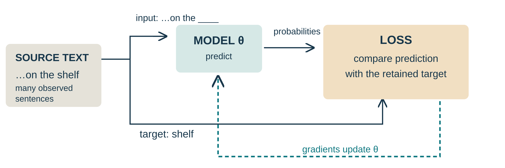
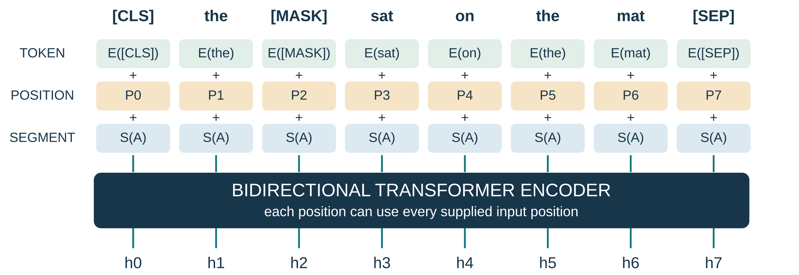
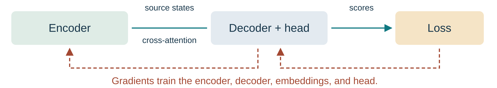
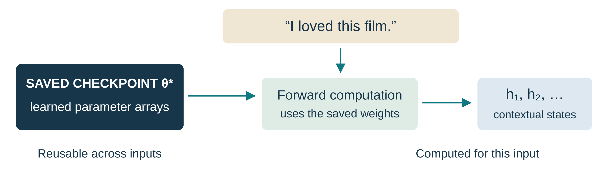

:::{.course-note-masthead .content-visible when-format="html"}

CS 351 · Introduction to Natural Language Processing 
Chapter 8 · Pretraining language models · Session 1

[Download the PDF](index.pdf){.btn .btn-primary}
:::

A Transformer architecture specifies how representations are computed. It does not, by itself, supply useful parameter values. **Pretraining** uses a broadly available learning signal to obtain parameters that can later be reused. In this chapter, that signal comes from observed text.

These notes accompany the completed first session. They assume that attention, Transformer blocks, autoregressive prediction, and basic cross-entropy have already been studied. The aim is to explain what changes when those mechanisms become **pretraining recipes**: the training objects, the conditioning information, the scored positions, and the parameters that learn. Detailed task heads, fine-tuning, and prompting belong to Session 2.

The exposition follows the Stanford and Berkeley lectures used in class [@yang2026pretraining; @berkeley2026pretraining]. Exact recipes and historical claims are attributed to the original ELMo, BERT, GPT, and T5 papers. Diagrams are static, and all toy numbers below are explicitly illustrative.

:::{.callout-note}
## Questions to keep in view

For every recipe, identify (1) the original text, (2) the supplied input, (3) the target retained for comparison, (4) the information available to that prediction, and (5) the parameters updated by the loss. Finally ask what the resulting checkpoint can contribute to a new task.
:::

# From pretrained embeddings to a pretrained model

## Static lookup and contextual computation

Consider *bank* in “she deposited money at the bank” and “they rested beside the river bank.” A static embedding table $E\in\mathbb{R}^{V\times d}$ supplies the same vector $E_{\mathrm{bank},:}$ in both sentences. This does not mean that a later network cannot distinguish the senses; it means that **the lookup itself does not depend on the context**. Word2Vec and GloVe illustrate influential ways of learning such reusable lexical representations [@mikolov2013distributed; @pennington2014glove].

A contextual model instead computes

$$
h_i=f_\theta(x_{1:n})_i\in\mathbb{R}^{d}.
$$ {#eq-contextual-state}

Here $x_i$ is a token occurrence, $f_\theta$ is a parameterized sequence model, and $h_i$ is the state computed for position $i$. Two occurrences of *bank* can have different states because their surrounding inputs differ. The saved parameters $\theta$ can remain identical across these two forward computations. A changed representation is not evidence that the model updated its weights.

The distinction matters for transfer. Reusing only $E$ transfers a lexical lookup. Reusing a pretrained contextual backbone transfers both lexical information and the learned transformations that combine context. The Transformer supplies one such backbone [@vaswani2017attention], but contextual pretraining did not begin with Transformers.

## ELMo as a historical bridge

ELMo builds contextual representations from a pretrained bidirectional language model with recurrent layers. Its left-to-right and right-to-left language models read different directional contexts; their states are combined for downstream use. This is different from BERT's joint bidirectional encoder computation [@peters2018elmo; @devlin2019bert].

One useful way to understand ELMo's downstream representation is its learned layer mixture:

$$
\operatorname{ELMo}^{\mathrm{task}}_i
=\gamma^{\mathrm{task}}\sum_{j=0}^{L}s_j^{\mathrm{task}}h_{i,j}^{\mathrm{LM}},
\qquad
s_j^{\mathrm{task}}=\frac{\exp(a_j)}{\sum_{k=0}^{L}\exp(a_k)}.
$$ {#eq-elmo-mixture}

The vector $h_{i,j}^{\mathrm{LM}}$ denotes the token representation from level $j$ of the pretrained language model; the contextual levels combine directional states. The task-specific coefficients $s_j$ form a normalized mixture, and $\gamma$ adjusts its scale. They allow a downstream task to emphasize different levels without treating the final layer as the only useful representation. This formula is included to clarify what is reused, not to introduce a new recurrent-network derivation; see @peters2018elmo, §§3.1–3.2.

Whole-model pretraining extends the reuse story: a task can initialize its backbone from pretrained weights and subsequently update that backbone. Whether the backbone is frozen or updated is an **adaptation choice**, not part of the definition of a contextual vector.

# Text supplies a supervised learning signal

## Fix the notation before constructing examples

Throughout the worked examples, use

$$
x=(x_1,\ldots,x_6)=(\text{the},\text{cat},\text{sat},\text{on},\text{the},\text{mat}).
$$

These are word-level teaching units. Real BERT, GPT, and T5 use model-specific subword tokenization and boundary conventions. In particular, T5's text processing uses SentencePiece; the distinction between words and subword tokens must be preserved when implementing the recipes [@kudo2018sentencepiece; @raffel2020t5].

| Symbol | Meaning |
|---|---|
| $x$ | Original token sequence retained by the data-construction procedure |
| $\widetilde{x}$ | Corrupted source supplied to a reconstruction model |
| $M$ | Selected token positions for BERT's MLM loss |
| $y$ | Decoder target sequence in the T5 example |
| $\theta$ | Trainable parameter arrays |
| $h_i$ | Contextual state computed for a particular input position |
| $z_i\in\mathbb{R}^{V}$ | Vocabulary logits for a prediction |
| $p_\theta$ | Conditional distribution obtained from the model |

The input and target are different roles, even when both are derived from the same text. Constructing a target does not mean supplying it to the prediction that is supposed to recover it.

## One sentence can provide several training questions

Under the rule “withhold exactly one position and predict its original token,” the sentence yields the following six examples.

| Supplied input | Retained target |
|---|---|
| `[MASK] cat sat on the mat` | `the` at position 1 |
| `the [MASK] sat on the mat` | `cat` at position 2 |
| `the cat [MASK] on the mat` | `sat` at position 3 |
| `the cat sat [MASK] the mat` | `on` at position 4 |
| `the cat sat on [MASK] mat` | `the` at position 5 |
| `the cat sat on the [MASK]` | `mat` at position 6 |

The two occurrences of `the` are different positions. We count constructed examples, not unique word types. These examples overlap heavily; they are not six independent corpus observations. Nor is this exhaustive enumeration BERT's actual sampling procedure. It isolates the principle that text already contains candidate targets.

{#fig-training-flow width=100%}

## The population objective includes example construction

Let $\mathcal{D}$ be a corpus distribution and $q(c\mid x)$ a distribution over training constructions, such as selected positions and corruption choices. The training objective can be written schematically as

$$
J(\theta)=\mathbb{E}_{x\sim\mathcal{D}}\,
\mathbb{E}_{c\sim q(\cdot\mid x)}
\left[\ell\bigl(\theta;\operatorname{input}(x,c),\operatorname{target}(x,c)\bigr)\right].
$$ {#eq-pretraining-expectation}

This expression separates three decisions: which text is sampled, how a learning problem is constructed, and how prediction errors are scored. A practical implementation approximates the expectation using finite data, batches, and sampled constructions. For a batch of $B$ examples, one simple convention is

$$
\widehat{J}_B(\theta)=\frac{1}{B}\sum_{b=1}^{B}\ell_b(\theta),
\qquad
\theta^{(k+1)}=\theta^{(k)}-\eta\nabla_\theta\widehat{J}_B(\theta^{(k)}).
$$ {#eq-update}

The second expression is an illustrative SGD update; it is not a claim that every original model used plain SGD. The reusable product is the learned parameter state after training. Changing the input during inference changes the computed activations; it does not perform @eq-update.

Self-supervision removes the requirement to annotate a separate task label for each constructed prediction. It does not remove decisions about data quality, sampling, leakage, vocabulary, or evaluation.

# Cross-entropy: from a retained token to parameter updates

## The target is an index in a vocabulary

For a vocabulary of size $V$, let $z_v$ be the logit for token $v$. The predicted probability is

$$
p_v=\frac{\exp(z_v)}{\sum_{u=1}^{V}\exp(z_u)}.
$$

If the observed target is token $a$, its one-hot target distribution is $q_v=\mathbf{1}[v=a]$. Cross-entropy becomes

$$
\ell(z,a)=-\sum_{v=1}^{V}q_v\log p_v
=-\log p_a
=-z_a+\log\sum_{v=1}^{V}\exp(z_v).
$$ {#eq-token-ce}

The loss rewards probability assigned to the **observed target**, not a binary judgment that a completion sounds plausible. Other completions may be linguistically acceptable while receiving no target mass in this example. This is a property of the observed-token training objective.

For numerical computation, log-softmax or a cross-entropy routine evaluates the log-sum-exp stably. Subtracting $m=\max_v z_v$ gives

$$
\log\sum_v e^{z_v}=m+\log\sum_v e^{z_v-m},
$$

without changing the result. This avoids exponentiating unnecessarily large logits.

## Why the error reaches the backbone

Differentiating @eq-token-ce gives

$$
\frac{\partial\ell}{\partial z_v}=p_v-\mathbf{1}[v=a].
$$ {#eq-logit-gradient}

For a simple output mapping $z=Wh+b$, with $W\in\mathbb{R}^{V\times d}$ and $h\in\mathbb{R}^{d}$,

$$
\nabla_h\ell=W^\top(p-q),\qquad
\nabla_W\ell=(p-q)h^\top,\qquad
\nabla_b\ell=p-q.
$$ {#eq-head-gradients}

These are the gradients for this illustrative linear head. Actual pretraining heads may include additional transformations, normalization, or tied embeddings. The same chain-rule principle sends the error into the contextual backbone: if $h=f_\theta(\cdot)$, then its parameter gradient contains $(\partial h/\partial\theta)^\top\nabla_h\ell$.

Suppose a toy vocabulary distribution is $(0.25,0.50,0.25)$ and the first token is the target. The logit gradient is $(-0.75,0.50,0.25)$. A gradient-descent step on independently adjustable logits would increase the target logit and decrease the others. A neural model instead updates shared parameters, so the resulting changes across examples are coupled. This calculation explains the local learning signal; it is not a measured BERT update.

## Normalization is part of the convention

For variable-length examples, averaging example means and averaging all valid target tokens are different choices:

$$
\mathcal{L}_{\mathrm{example}}
=\frac{1}{B}\sum_{b=1}^{B}\frac{1}{N_b}\sum_{t\in I_b}\ell_{b,t},
\qquad
\mathcal{L}_{\mathrm{token}}
=\frac{\sum_b\sum_{t\in I_b}\ell_{b,t}}{\sum_b N_b}.
$$

Here $I_b$ is the set of scored positions and $N_b=|I_b|>0$. The first gives each example equal weight; the second gives each scored token equal weight. If all $N_b$ are equal, they coincide. Our one-example exercises use the mean over that example's valid targets. Padding labels are excluded, and an implementation must handle or avoid examples with zero valid targets.

# BERT: recover selected original tokens

## Input vectors and bidirectional states

In the original BERT input representation, a position receives the sum of token, position, and segment embeddings [@devlin2019bert, §3 and Fig. 2]:

$$
e_i=E_{\mathrm{tok}}[\widetilde{x}_i]+E_{\mathrm{pos}}[i]+E_{\mathrm{seg}}[s_i],
\qquad
H=\operatorname{Encoder}_\theta(e_{1:n}).
$$ {#eq-bert-input}

The three terms have the same hidden dimension $d$, so they are added coordinate by coordinate. They are not concatenated. BERT's position embeddings are learned. Segment IDs distinguish the two text segments in a paired input.

{#fig-bert-input width=100%}

`[CLS]` supplies a contextual state used by sequence-level prediction heads; it is not an arithmetic mean of token states. `[SEP]` marks a separator or end boundary. In the single-segment figure, all segment IDs are A. In a paired example, the second segment uses B. Padding, if present, has its own attention/loss handling.

At a masked position, the token lookup uses the `[MASK]` ID. The original target is not secretly inserted as its embedding. The encoder can use both sides of the **supplied corrupted input**, but cannot recover the hidden word merely by reading an unavailable original token.

## Selection and corruption are separate random choices

Let $M$ be the positions selected as MLM targets. Original BERT selects approximately 15% of eligible positions and applies a conditional corruption choice to each selected position [@devlin2019bert, §3.1]. In schematic notation,

$$
\widetilde{x}_i=
\begin{cases}
 x_i, & i\notin M,\\
 \texttt{[MASK]}, & i\in M\text{ and mask branch},\\
 r_i, & i\in M\text{ and random-token branch},\\
 x_i, & i\in M\text{ and unchanged branch}.
\end{cases}
$$

Within $M$, the branch probabilities are 0.80, 0.10, and 0.10. The retained label remains $x_i$ in every branch. Special boundary and padding positions are not targets in our construction.

For the selected word `cat`, the three inputs and targets are:

| Branch | Input at the selected position | Retained target |
|---|---|---|
| Mask | `[MASK]` | `cat` |
| Random replacement | `table` in this fixed illustration | `cat` |
| Unchanged | `cat` | `cat` |

The random branch draws a vocabulary token, not a purposeful misspelling. An unchanged selected position still has a loss term. An unselected unchanged position does not. The model is not given a separate selected-position flag; the data/loss procedure retains the selection set.

Multiplying probabilities gives approximate population proportions: $0.15\times0.80=0.12$ for the mask branch, and $0.15\times0.10=0.015$ for each other selected branch, with 0.85 unselected. These describe branch membership, not guaranteed proportions in each short sequence. A random replacement can also happen to equal the original token. Mixing branches reduces reliance on the artificial mask marker; it does not eliminate the pretraining/downstream mismatch or make every selected target equally difficult.

## The MLM objective

For a nonempty selected set $M$, define

$$
\mathcal{L}_{\mathrm{MLM}}(\theta;x,M,\widetilde{x})
=-\frac{1}{|M|}\sum_{i\in M}\log p_\theta(x_i\mid\widetilde{x}).
$$ {#eq-mlm}

Each distribution is read at the corresponding selected position. The original token $x_i$ appears in the target, while $\widetilde{x}$ supplies the encoder input. The notation abbreviates the position-specific vocabulary distribution. All selected positions count, including random and unchanged branches.

:::{.callout-important}
## Worked example: two simultaneous masks

Original: `the cat sat on the mat`  
Input: `the [MASK] sat on the [MASK]`  
Selected positions: $M=\{2,6\}$.

Suppose the model assigns illustrative probabilities $p(x_2=\text{cat}\mid\widetilde{x})=0.25$ and $p(x_6=\text{mat}\mid\widetilde{x})=0.50$. Then

$$
\ell_2=-\ln(0.25)=\ln 4\approx1.3863,\qquad
\ell_6=-\ln(0.50)=\ln 2\approx0.6931,
$$

$$
\mathcal{L}_{\mathrm{MLM}}=\frac{\ell_2+\ell_6}{2}
\approx1.0397\text{ nats}.
$$

Average over the two selected positions, not all six words. Both probabilities condition on the same input with both masks present. The lower probability for `cat` contributes the larger penalty.
:::

Unlike the causal chain rule, this sum is **not** a left-to-right factorization of the probability of the full original sentence. It is a reconstruction objective conditioned on a corrupted observation. Exponentiating this MLM mean is not directly comparable to ordinary causal-language-model perplexity on a different target set.

## No direct loss does not mean no gradient

Let $z_i$ be the logits for a selected output and $e_j$ the embedding at any supplied input position. The chain rule gives

$$
\frac{\partial\mathcal{L}_{\mathrm{MLM}}}{\partial e_j}
=\frac{1}{|M|}\sum_{i\in M}
\left(\frac{\partial z_i}{\partial e_j}\right)^\top(p_i-q_i).
$$ {#eq-context-gradient}

Even if $j\notin M$, its representation may influence a selected output through attention and later layers. Therefore the corresponding Jacobian need not be zero. This explains why unselected context tokens can help train the model without receiving their own direct MLM terms.

During pretraining, embeddings, encoder layers, and the prediction head learn together. BERT's MLM head has details beyond the simple linear-head illustration; consult its paper and implementation when reproducing the exact architecture. The principle in @eq-context-gradient does not require those details to be identical.

## Original BERT's sentence-pair objective

Original BERT also trained next-sentence prediction (NSP). A pair is encoded as `[CLS] A [SEP] B [SEP]`. In the training construction, B is an actual continuation half the time and a randomly sampled alternative half the time. Segments can contain more than one grammatical sentence. The binary label comes from document order and sampling [@devlin2019bert, §3.1].

Let $r\in\{0,1\}$ be that label and $\pi_\theta(A,B)$ the classifier's probability of the continuation label. Its binary cross-entropy is

$$
\mathcal{L}_{\mathrm{NSP}}
=-r\log\pi_\theta-(1-r)\log(1-\pi_\theta).
$$

The original training combines the MLM and NSP losses. NSP is not a truth detector: a randomly sampled passage can sound plausible. It is also not the definition of every encoder pretraining recipe. Here it provides historical context rather than a second extended loss exercise.

# GPT: the familiar AR objective used for pretraining

## The mechanism is familiar; the training stage is the focus

The autoregressive language-model objective has already been derived in earlier chapters. Generative pretraining uses that familiar signal over corpus text to learn reusable parameters. The original GPT work explicitly followed language-model pretraining with supervised task adaptation [@radford2018generative, §3]. A causal decoder is therefore not restricted to continuation as its only downstream use.

For a source window $x_{1:n}$, the probability of a continuation conditional on its initial context follows the chain rule:

$$
p_\theta(x_{2:n}\mid x_1)
=\prod_{t=2}^{n}p_\theta(x_t\mid x_{<t}),
\qquad
\mathcal{L}_{\mathrm{AR}}
=-\frac{1}{n-1}\sum_{t=2}^{n}\log p_\theta(x_t\mid x_{<t}).
$$ {#eq-causal-pretraining}

The conditioning convention is deliberate: our classroom window supplies the first `the` as context, without a separate START token. A formulation with a start symbol can also score the first word, but would be a different boundary convention.

For the running example:

| Position in the supplied row | Input token | Aligned next-token target |
|---:|---|---|
| 1 | `the` | `cat` |
| 2 | `cat` | `sat` |
| 3 | `sat` | `on` |
| 4 | `on` | `the` |
| 5 | `the` | `mat` |

Thus the denominator is five. The causal restriction prevents a prediction from using later input positions even though training can process the observed row together. There is no separate target after `mat` in this finite window, and no EOS target is included in this example.

## What the objective changes

Compared with BERT's selected reconstruction targets, this recipe scores every eligible next-token target in the window. It uses the observed prefix rather than both sides of a corrupted sequence. These choices change the learning signal; they do not establish that one recipe is universally better.

Corpus preprocessing determines which token windows are sampled and how document boundaries are handled. Training updates embeddings, the causal stack, and the vocabulary prediction mapping. The saved checkpoint contains these learned arrays, with their matching tokenizer and configuration. Some output weights may be tied to embedding weights; tied use does not create independent copies of the parameters.

The architectural name *autoregressive* describes the conditional structure. *Pretraining* describes the stage's role in a reuse workflow. Increasing corpus size is not a new kind of gradient descent, and size alone is not the defining property of pretraining.

## At ordinary use, the checkpoint is fixed

In corpus pretraining, observed next tokens provide labels for a loss and optimizer updates. During ordinary continuation, an input prompt produces probabilities using a saved parameter state. The subsequent text can change the next computation's input, while the parameter arrays remain fixed. This is the distinction needed here; decoding and sampling mechanisms were covered earlier.

A model trained for text continuation may display useful behavior on prompts, but its objective alone does not guarantee reliable instruction following. The existence of a pretrained checkpoint should not be conflated with a completed assistant-training pipeline. Session 2 and the following lecture will study these reuse and adaptation questions separately.

# T5: learn by reconstructing missing spans

## Source and target are separate sequences

T5 uses an encoder–decoder text-to-text interface. In span-corruption pretraining, removed spans become an output sequence, while the remaining text becomes a corrupted source. The paper's construction replaces each removed span with a distinct sentinel and uses those sentinels to delimit the target spans, including a final sentinel [@raffel2020t5, Fig. 2].

For the running sentence, remove `cat` and `mat` as two one-word spans. Write $S_0,S_1,S_2$ as readable aliases for distinct extra-ID sentinel tokens. Under the paper-style convention used in the lecture,

$$
\widetilde{x}=(\text{the},S_0,\text{sat},\text{on},\text{the},S_1,\mathrm{EOS}),
$$

$$
y=(S_0,\text{cat},S_1,\text{mat},S_2,\mathrm{EOS}).
$$ {#eq-t5-target}

The source's $S_0$ marks the first missing span; the target's $S_0$ introduces its content. The same relationship holds for $S_1$. The final $S_2$ closes the last span; it is not evidence of a third source gap. EOS terminates a sequence and is distinct from a sentinel.

The visible aliases correspond to tokens such as `<extra_id_0>`, not ordinary character strings that the example asks students to split. Our words are pedagogical units, not an exact SentencePiece tokenizer trace. The final-sentinel convention follows the paper illustration; a real data pipeline's boundary behavior should be checked rather than inferred from a six-word schematic.

## One sentinel can replace several tokens

Extending the first removed span from `cat` to `cat sat` changes the pair to

$$
\widetilde{x}'=(\text{the},S_0,\text{on},\text{the},S_1,\mathrm{EOS}),
$$

$$
y'=(S_0,\text{cat},\text{sat},S_1,\text{mat},S_2,\mathrm{EOS}).
$$

The first gap grows but still has a single sentinel. The output contains removed content and boundary markers rather than a copy of every uncorrupted source token. On long sequences with a modest noise fraction, this can shorten the reconstruction target compared with reconstructing the whole input. On a tiny example, marker overhead may eliminate that saving.

The selected T5 recipe uses a noise density of 15% and mean span length 3; these are recipe-level settings over tokenized sequences [@raffel2020t5, §§3.3.3–3.3.4]. Our handpicked gaps deliberately prioritize inspectability and do not satisfy those statistics. A short example should not be used to estimate the production masking rate.

## Align the decoder input and target

For the one-word-span example in @eq-t5-target:

| Decoder input | START | $S_0$ | cat | $S_1$ | mat | $S_2$ |
|---|---|---|---|---|---|---|
| Target | $S_0$ | cat | $S_1$ | mat | $S_2$ | EOS |

START is an input initialization symbol, not an additional target. Original T5 uses its configured pad-token ID in this role. This does not make the first target a padded label: the role of a decoder-start input and the role of loss-ignored padding are different.

The decoder conditions on the corrupted source through encoder memory and on previous target tokens during training. It does not receive the missing current target as part of its own prefix. The source's EOS is an encoder input, not a separate decoder reconstruction target at that position.

## Conditional cross-entropy and the encoder's gradient

For $m=|y|$ non-padding target tokens,

$$
\mathcal{L}_{\mathrm{T5}}(\theta)
=-\frac{1}{m}\sum_{t=1}^{m}
\log p_\theta(y_t\mid y_{<t},\widetilde{x}).
$$ {#eq-t5-loss}

In the displayed example, $m=6$: three sentinels, two content tokens, and EOS. Sentinels and EOS are valid vocabulary targets and contribute loss. No numerical probabilities are supplied here because the important new issue is the source/target construction, not another cross-entropy calculation.

{#fig-t5-gradients width=100%}

Write the source memory as $H=\operatorname{Enc}_{\theta_E}(\widetilde{x})$ and a decoder state as $s_t=\operatorname{Dec}_{\theta_D}(y_{<t},H)$. If $z_t$ denotes its logits, then

$$
\nabla_{\theta_E}\mathcal{L}_{\mathrm{T5}}
=\frac{1}{m}\sum_{t=1}^{m}
\left(\frac{\partial H}{\partial\theta_E}\right)^\top
\left(\frac{\partial z_t}{\partial H}\right)^\top
(p_t-q_t).
$$ {#eq-encoder-gradient}

The dependence of $z_t$ on $H$ includes decoder cross-attention. Consequently, an encoder can learn without an independent encoder-side prediction head. The formula isolates the encoder path for explanation; when parameters are shared between components, their gradients accumulate contributions from all uses.

## The same interface can support a different supervision source

T5's text-to-text formulation also represents supervised tasks using input and target strings [@raffel2020t5, §2.4 and Fig. 1]. For example, a sentiment task may pair `sst2 sentence: I loved this film.` with `positive`, while a translation task pairs an English input with its French target. These are task-format examples, not outputs measured from a span-pretrained model.

The distinction is the source of supervision. Missing-span targets can be constructed from corpus text; sentiment and translation targets come from task annotations or paired data. A task prefix is a learned cue in the corresponding training setup, not a guarantee of zero-shot ability. These examples motivate reuse, while the detailed adaptation procedure is deferred to Session 2.

# Compare the recipes without conflating their losses

The following comparison uses precisely the boundary conventions above.

| Recipe | Supplied input | Scored targets |
|---|---|---|
| BERT MLM | `the [MASK] sat on the [MASK]` | `cat` and `mat` at selected positions |
| GPT | `the cat sat on the` under causal visibility | `cat sat on the mat` |
| T5 encoder | `the S0 sat on the S1 EOS` | No independent encoder token loss |
| T5 decoder | `START S0 cat S1 mat S2` plus source memory | `S0 cat S1 mat S2 EOS` |

The parameter sets differ, but in each case the learning signal trains a contextual backbone. Original BERT includes its additional NSP objective. GPT pretraining learns a causal backbone and output mapping. T5 trains both stacks through its conditional reconstruction objective.

Do not rank these models by comparing the numerical mean loss of our toy examples. Their target sets, conditions, boundary symbols, and sometimes tokenizations differ. Even target counts are not measures of model quality. A meaningful comparison specifies data, model/compute budgets, evaluation splits, metrics, and the downstream or held-out prediction problem.

Similarly, **perplexity is tied to a defined probability model and evaluation convention**. For a causal model on a fixed target set, exponentiating the mean negative log-likelihood yields perplexity under that convention. An exponentiated masked reconstruction loss does not become the same quantity merely because both losses contain logarithms.

# What is saved, and what remains to be learned?

A checkpoint stores learned parameter arrays. The tokenizer and model configuration must agree with those arrays. A contextual state is a result of applying the model to an input, not an alternative name for a weight. A retained token target or sentiment annotation is a supervision object, not a hidden-state vector.

{#fig-weights-states width=100%}

For the next session, consider “I loved this film.” with an annotated sentiment label `positive`. Pretraining has supplied parameters useful as a starting point. It has not, merely by doing so, specified the task's output space, the mapping to those outputs, which parameters should update, or the held-out evaluation procedure. These are adaptation decisions.

The question to carry forward is: **we trained a word predictor; how can it become a sentiment classifier?** Session 2 will answer it with task heads, frozen features versus full updates, concrete evaluation examples, and prompting.

# Study exercises and worked answers

## Exercises

1. **Selection versus corruption.** A BERT position is selected but left unchanged. Does it contribute an MLM loss? How does it differ from an unselected unchanged position?
2. **Normalization.** Two selected targets have illustrative probabilities 0.20 and 0.80. Compute their mean negative log-likelihood in nats. Explain why dividing by the full sentence length is wrong for this exercise.
3. **Context gradients.** A BERT context token has no direct loss term. Use @eq-context-gradient to explain how its embedding can still receive a gradient.
4. **Boundary conventions.** Construct the GPT input and target for `the cat sat on the mat` under our no-START convention. What changes if a START token is introduced and the first observed word is also scored?
5. **Multiword span.** Remove `cat sat` and `mat`. Write T5's source, decoder input, and target with our final-sentinel/EOS convention. Identify every scored target.
6. **Objects in a workflow.** Classify each item as parameter, activation, or supervision: an embedding-table row, the contextual state for *bank* in a sentence, the retained original `cat`, and the label `positive`.
7. **Comparison claim.** A student's BERT mean MLM loss is below another student's causal LM loss. Give two reasons why that alone cannot establish that BERT is the better pretrained model.

## Worked answers

**1.** The selected unchanged position contributes a loss against its original token. The unselected position has no direct MLM term, even though both appear unchanged to the encoder. The selection set is known to the data/loss computation, not passed as a separate input flag.

**2.** The contributions are $-\ln0.20\approx1.6094$ and $-\ln0.80\approx0.2231$. The mean is $(1.6094+0.2231)/2\approx0.9163$ nats. The denominator is the number of selected targets under this exercise's definition, not the number of visible or original words.

**3.** A selected output can depend on that context embedding. Therefore $\partial z_i/\partial e_j$ can be nonzero even when $j\notin M$. The chain rule transmits the selected-output error along that dependence.

**4.** Input: `the cat sat on the`; target: `cat sat on the mat`. There are five valid targets. With a START token and a scored first word, input becomes `START the cat sat on the` and target becomes `the cat sat on the mat`, yielding six. Neither convention should be silently mixed with the other.

**5.** Source: `the S0 on the S1 EOS`. Target: `S0 cat sat S1 mat S2 EOS`. Decoder input: `START S0 cat sat S1 mat S2`. All seven target tokens are scored, including sentinels and EOS. START is an input, and the source EOS has no separate decoder loss term. These are word-level teaching strings.

**6.** The embedding-table row is a parameter (a slice of a learned array). The contextual state is an activation computed for one input. `cat` and `positive` are supervision: the former is obtained from source text, the latter from a task annotation.

**7.** The models score different targets under different conditioning information. They may also use different tokenization, corruption rates, boundaries, data splits, and averaging rules. A lower loss on a different problem is not a controlled comparison of transfer usefulness.

# A guided route through the literature

Read the original papers with a notebook open. For each, reconstruct one training example, write its loss, and identify the transferred parameters. Do not begin by memorizing benchmark scores.

1. **ELMo — @peters2018elmo.** Read §§3.1–3.2, particularly the bidirectional language model and task-specific layer mixture. Ask why one static word vector cannot express context dependence, and distinguish directional model states from the final task representation. Then inspect the analyses rather than inferring semantic understanding solely from a vector illustration.
2. **BERT — @devlin2019bert.** Start with Figs. 1–2 and §3.1. Reconstruct selection, corruption, and the retained targets. Read §3.2 to see where supervised adaptation enters, without assuming that the pretraining head is already a classifier for every task. In the ablations, check which components and evaluation tasks are being compared.
3. **Original GPT — @radford2018generative.** Focus on §3.1 versus §3.2: the familiar LM objective supplies initialization, then a task-specific supervised objective adapts it. Fig. 1 shows how structured tasks are represented. Read the transfer story before equating “generative” with “only useful for generation.”
4. **T5 — @raffel2020t5.** Begin with Fig. 1 (task interface) and Fig. 2 (span construction). Then read §§3.3.1–3.3.4 on objective design, corruption rate, and span length. Distinguish the baseline construction, controlled comparisons, and final recipe. The paper is a systematic study, not just a model diagram.
5. **Lecture companions.** Stanford PDF pp. 10–11 and 19 explain the move from embedding reuse to whole-model reuse; pp. 27–28 cover BERT, and p. 36 illustrates T5. Berkeley PDF pp. 36/58 form a matched MLM/causal pair, p. 38 explains corruption branches, pp. 57–59 discuss generative pretraining, and p. 66 illustrates T5 [@yang2026pretraining; @berkeley2026pretraining]. These are PDF viewer page numbers, not necessarily printed slide numbers.

The papers use different historical settings and conventions. When translating an idea into code, verify tokenizer behavior, special IDs, loss masks, parameter sharing, and normalization against the intended implementation. The small examples in these notes explain the objective; they are not a substitute for a full reproduction specification.

# References {.unnumbered}

::: {#refs}
:::
